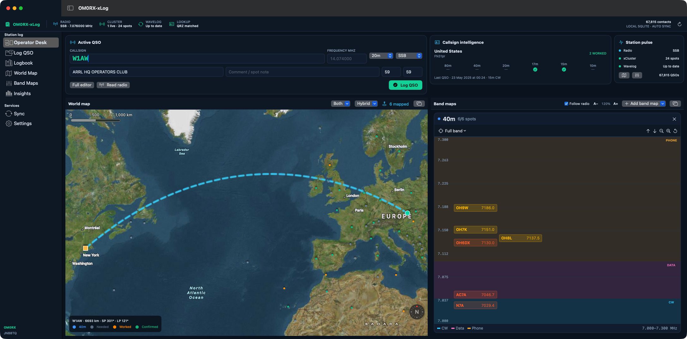
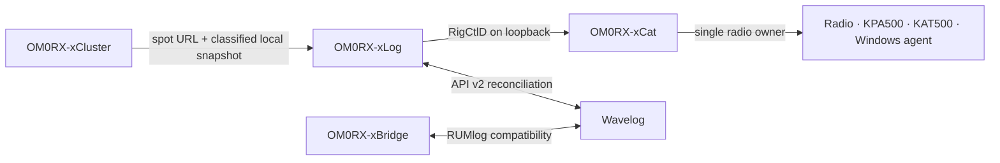
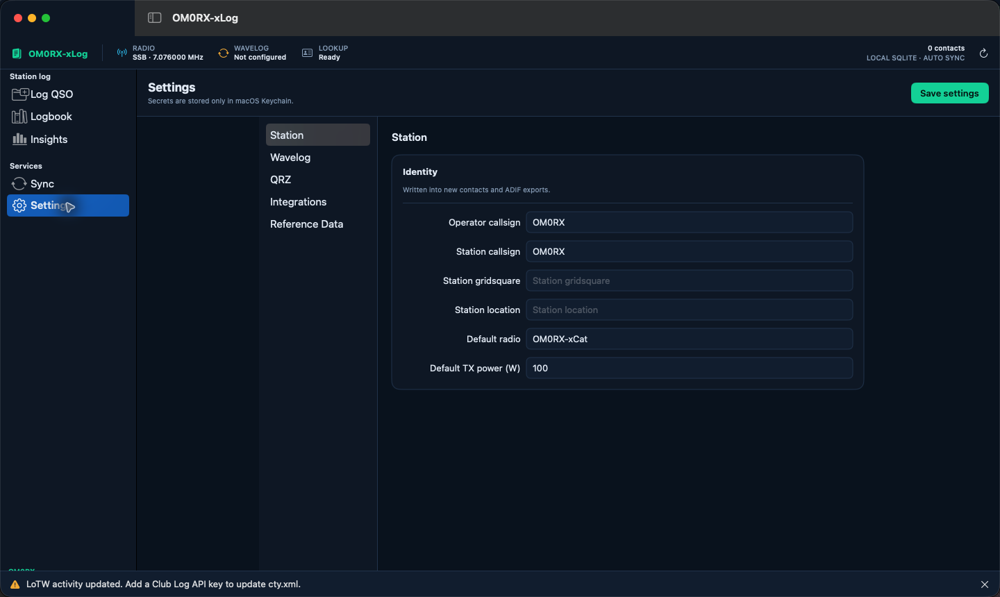
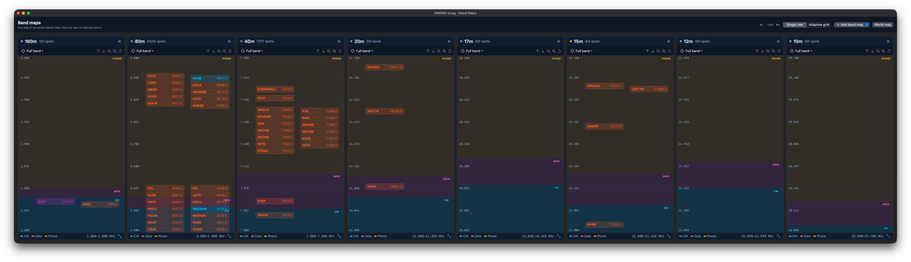

# OM0RX-xLog

[](#requirements)
[](Package.swift)
[](LICENSE)
[](https://github.com/oliverbross/OM0RX-xLog/releases/tag/v0.3.0)

OM0RX-xLog is a fast, local-first amateur-radio logbook for macOS. It is the logging centre of the OM0RX station suite: contacts are committed to a local SQLite database first, enriched from QRZ and current reference data, synchronized in both directions with Wavelog, and connected to the radio through OM0RX-xCat.

Created and maintained by **Oliver Bross, OM0RX**.

Development scope, acceptance evidence and the prioritized backlog are tracked in [PROJECT_STATUS.md](PROJECT_STATUS.md).



## What is included

- Native SwiftUI macOS application; no embedded web view.
- Local SQLite logbook that works without Wavelog or an internet connection.
- Wavelog-style field groups: QSO, Station, General, Notes and QSL.
- Built-in, two-way Wavelog API v2 synchronization for new, edited and deleted contacts; OM0RX-xBridge remains available for RUMlog users but is not required by xLog.
- Full QSO editing plus explicit conflict review when both xLog and Wavelog changed the same contact.
- Lossless ADIF import/export: unknown application fields are retained.
- QRZ XML callsign lookup without overwriting values the operator already entered.
- Bundled CTY fallback plus authenticated Club Log `cty.xml`, LoTW activity and Wavelog catalog updates.
- Previous-QSO history and a worked/confirmed band-mode matrix beside the active contact.
- An operator desk that keeps the compact logger, callsign intelligence, station state, world map and selected band maps visible together.
- Resizable, independently undockable World Map and Band Maps windows for multi-screen stations.
- A hybrid/satellite world map that opens on the operator grid, with high-contrast classified spot labels, prominent semantic-colour DXCC prefixes, a worked/confirmed DXCC entity overlay and an accurate great-circle rotor path with short- and long-path bearings.
- One, several or all band maps, each with full-band and CW/data/phone presets, pan/zoom controls, allocation lanes and collision-free spot labels.
- Cluster intelligence controls for callsign/country/note search, worked-state and mode filtering, priority spots and an inline classification inspector without replacing the frequency-accurate band-map workflow.
- A searchable 192-entry awards library: all 190 source-backed research programmes plus the existing WAPC and WCSA native calculators, with geography, sponsor, implementation-state and free-text filters.
- Nine live native rule packs for AJD, WAJA, JCC, JCG, AJA, WACA, WAGA, WAPC and WCSA, showing separate worked, evidence-eligible and sponsor-credit states without equating a local result with an issued award.
- Explicit tracking, blocked and historical states for every non-executable programme, including current source links, review dates, open dependencies and a generated per-programme [coverage ledger](docs/AWARDS_COVERAGE.md).
- Local worked/confirmed progress for DXCC, WAZ, WAS and four-character Maidenhead fields, plus milestone achievements and mode/band/continent/year operating summaries. These remain operator estimates rather than sponsor award certification.
- Grid-derived local weather from Open-Meteo, shown alongside xCat's live solar and day/night band-condition telemetry with a last-good-data fallback.
- Structured POTA, SOTA, IOTA, WWFF and castle-reference promotion from cluster comments and special badges into the matching ADIF fields.
- Fast local search, compact statistics and visible sync state.
- OM0RX-xCat RigCtlD integration for live frequency/mode and one-transaction frequency-plus-mode tuning.
- Optional deduplicated forwarding of the filtered xCluster feed to FLEX through xCat's loopback RUMlog-compatible UDP bridge; xLog never owns the radio directly.
- `om0rx-xlog://spot` handoff for OM0RX-xCluster and other local tools.
- Secrets stored in macOS Keychain.

## Suite architecture



xCat remains the only process that owns the physical radio connection. xLog never competes with it for CAT access. xBridge remains useful when RUMlog must coexist, but xLog itself does not require RUMlog.

## Requirements

- macOS 13 Ventura or newer.
- OM0RX-xCat running when live frequency/mode or tuning is required.
- A Wavelog instance with an API v2 token for synchronization.
- An eligible QRZ XML subscription for full QRZ lookup data.
- A Club Log application API key to download the official `cty.xml`; LoTW activity updates do not require it.

## Configuration

Open **Settings** in xLog:

1. **Station** — enter station/operator callsigns, gridsquare, station location, radio and default power.
2. **Wavelog** — enter the instance URL, station profile ID and an API v2 token beginning with `wl2_`.
3. **QRZ** — enable lookup and enter QRZ XML credentials.
4. **Integrations** — keep xCat on `127.0.0.1:14532` unless its RigCtlD listener was deliberately changed.
5. **Reference Data** — enter a Club Log application API key and retain the official CDN endpoint. LoTW activity is refreshed independently.

The **Band Maps** settings page configures two independent workspaces:

- **Operator Desk** — show one or more chosen bands, or enable **Follow radio** so the desk always follows the band reported by xCat.
- **Undocked Band Maps** — keep a different persistent selection, including **All bands**, and choose **Single row** for an ultrawide display or **Adaptive grid** to use both the width and height of the window.

Band-map text can be scaled from 80–200% for high-density and 4K displays. Panels resize with their window, and frequency spacing plus collision avoidance scale with the available height rather than leaving unused space.

The **Insights** workspace calculates award progress from the complete local SQLite log rather than the limited on-screen QSO table. Its Awards Library searches and filters 192 entries by region and delivery state. Nine native calculators evaluate AJD, WAJA, JCC, JCG, AJA, WACA, WAGA, WAPC and WCSA, including historical Japanese entity dates, WAPC band/mode matrices and WCSA school slots. Each live detail separates contacts worked from evidence-eligible contacts and leaves sponsor credit explicitly unavailable until authoritative credit is imported. The remaining records are visibly classified as research tracking, blocked with a named dependency, or historical; a research record is never presented as an executable rule pack merely because it is in the catalogue.

The full Log QSO editor presents contact/location, award references, notes, station and QSL fields together on one screen at normal desktop sizes. When xCat station telemetry is available, xLog automatically records transmitted power in ADIF `TX_PWR`: measured RF output is retained for the active QSO, with the current RF-drive setting and then the configured station default used as fallbacks.

Wavelog and QRZ credentials and the Club Log API key are stored in Keychain; they are not written to preferences, the logbook database or diagnostic output.

xLog accepts either the Wavelog site URL (for example `https://log.example.com`) or the full API-v2 URL ending in `/index.php/api/v2`. The first synchronization is read-first: xLog downloads and reconciles the complete remote log before it may upload safe local changes. Existing xBridge users can reuse the same station profile and credential, while xBridge itself remains unchanged.



## Cluster handoff

xLog registers this URL scheme:

```text
om0rx-xlog://spot?call=RG1L%2FMM&frequency=14.006500&mode=CW&comment=DX
```

Opening it first clears fields belonging to the previous contact, then loads the call, frequency, mode and note into the editor, promotes recognized activation references to their ADIF fields, and asks xCat to tune frequency and mode coherently. The QSO is not logged until the operator presses **Log QSO**. A visible **Clear** action is also available beside **Log QSO**. When the spot originates inside the Operator Desk, xLog keeps the desk visible and draws the station-to-DX great-circle path.

## Data and synchronization

The database lives at:

```text
~/Library/Application Support/OM0RX-xLog/OM0RX-xLog.sqlite
```

Each QSO has a stable local UUID, optional Wavelog ID, complete JSON record, searchable columns, dirty state and deletion tombstone. Synchronization first reads Wavelog and compares it with the last synchronized baseline, records any two-sided edit as an explicit conflict, and only then pushes safe pending changes. **Keep local** and **Use Wavelog** choices are presented in Sync; xLog never silently overwrites either version.

## Operator maps

The world map defaults to a readable hybrid/satellite base and can switch to Satellite or Standard. Before a DX target exists it opens centered on the configured operator grid. Its overlay menu shows live spots, all CTY-derived DXCC entity centroids, or both. Live spots follow the Operator Desk band selection and use high-contrast badges in each band's configured xCluster colour. DXCC prefixes use roughly twice the former type size, bold semantic-colour text and a dark backing: grey needed, orange worked and green confirmed. Enter a station gridsquare to enable the great-circle line, distance, and short-/long-path rotor bearings. When a callsign resolves, the camera automatically frames the home marker, DX marker and complete path with usable padding; manual pan and zoom remain available afterward.

Band-plan shading is an operating aid. Allocations vary by country, licence and IARU region, so the operator remains responsible for using frequencies permitted by their licence. The panel controls can show the whole band, jump to CW/data/phone portions, zoom in or out and pan along the band. Spot labels use the exact xCluster status colours and a collision-aware layout. xCluster publishes its already-filtered view, so band maps follow the same bands, modes, continent, call/DXCC status, special, source, worked-state, search and maximum-spot filters as the cluster table. The undocked window can arrange its independent band selection in one full-height horizontal row or an adaptive grid.



Double-click a Logbook row to edit it. Delete asks for confirmation and remains undoable until the next synchronization.

Reference files are kept under:

```text
~/Library/Application Support/OM0RX-xLog/Reference Data/
```

Downloads are validated and replaced atomically; a failed update leaves the last known good file active. When a source supplies `ETag` or `Last-Modified`, xLog stores that validator and revalidates conditionally instead of downloading an unchanged dataset again. Reference Data settings show the cache size, last successful check and published validator for Club Log CTY, LoTW activity and the Wavelog catalog.

Station weather uses the configured station gridsquare, converts it to coordinates locally and requests only current conditions from Open-Meteo every 15 minutes. Weather failure never interrupts logging, CAT, cluster or synchronization; xLog retains the last successful observation and marks it accordingly.

The same page manages offline activation directories. xLog downloads the official POTA park CSV, SOTA summit CSV, IOTA group JSON and WWFF directory CSV, validates both schema and minimum record count, then atomically replaces the last-known-good copy. Exact matches appear beneath POTA/SOTA/IOTA/WWFF entry fields; partial references show the first matching suggestion. A location button beside an exact match can explicitly use that reference as the current QSO's map target; this never turns the rotor automatically. Settings shows each source's record count, size, last successful check and published validator. Unknown values are retained and never prevent logging. The WCA/castle field currently remains pass-through because the programme's published bulk spreadsheet link is unavailable; the limitation is shown truthfully in Settings.

## Backup and recovery

Settings → **Backup & Restore** creates a portable `.xlogbackup` package containing a consistent SQLite snapshot, non-secret station settings, band-map/intelligence workspace preferences and the current reference-data cache. Every package carries a manifest with record counts, pending-sync count, last-QSO time, byte size and SHA-256 checksum. xLog also runs SQLite integrity checking before accepting a backup or offering it for restore.

Restore always starts with a read-only preview. If confirmed, xLog first writes a verified snapshot of the current profile under:

```text
~/Library/Application Support/OM0RX-xLog/Recovery/
```

The replaced database is retained as a timestamped rollback file. Wavelog, QRZ and Club Log credentials remain in macOS Keychain and are deliberately excluded from backup packages and restore operations.

## Keyboard workflow

- **⌘L** — return to Log QSO.
- **⌘Return** — save the active QSO locally.
- **⌘⇧R** — read frequency and mode from xCat.
- **⌘⇧S** — synchronize with Wavelog.

## Build and test

```bash
swift test
./scripts/package-app.sh
open dist/OM0RX-xLog.app
```

The packaging script creates and verifies a signed application bundle in `dist/`. It uses a Developer ID Application identity when one is available and otherwise creates an ad-hoc signature.

For a release machine with the `OM0RX-notary` Keychain profile configured, build, submit, staple, Gatekeeper-check and recreate the distributable ZIP with:

```bash
./scripts/notarize-release.sh
```

## Security and release status

- Network services use HTTPS except for the explicit loopback xCat connection.
- No credential is bundled with the project.
- Release downloads are Developer ID signed, Apple-notarized and carry a stapled ticket; the release script requires an accepted receipt before recreating the final ZIP.
- Live Wavelog, QRZ and Club Log acceptance depends on credentials supplied by the operator; automated tests do not prove those account-bound paths.

## License

Copyright © 2026 Oliver Bross OM0RX.

OM0RX-xLog is released under the [GNU General Public License v3.0](LICENSE).

The cluster, award and environmental-intelligence expansion was inspired by Balazs Valkony HA5XB's [HamLedger](https://github.com/valibali/hamledger). The xLog implementation is native Swift/SQLite work designed for the existing OM0RX architecture; no HamLedger source or assets are included.

The extended JARL, WAPC and WCSA award logic and bundled reference datasets are adapted from BI1GHZ's MIT-licensed [ham-award-tools](https://github.com/cebarobot/ham-award-tools), reference commit `f28a04fa5a94368ac4099ce5cec97fcd93ce0849`. Its complete MIT notice is distributed in `Sources/XLogCore/Resources/ham-award-tools-LICENSE.md` and in the packaged application resources.

The worldwide awards research registry is a dated, source-linked implementation input supplied for this project. It retains official source URLs and unresolved questions, contains summaries rather than reproduced rulebooks, and is deliberately gated from qualification claims until a complete executable rule pack and required reference data are audited.
