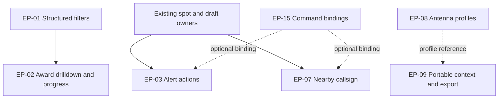

# OM0RX-xLog QLog Inspired Enhancements

**Master implementation and project management plan**

**Version:** 1.0  
**Prepared:** 3 November 2026, Australia/Darwin  
**Source review:** 2 November 2026 UTC (3 November in Darwin)  
**Product owner:** Oliver Bross, OM0RX / VK8RX  
**Repository:** [oliverbross/OM0RX-xLog](https://github.com/oliverbross/OM0RX-xLog)  
**Planning baseline:** `main` at `f15dbb11eb727419689869f8f4907ed9b4809970`  
**Installed macOS baseline recorded by the repository:** 1.4.8, package source `2ae0939d1a69fb8c8210a24880b04929b8d46d7c`  
**Comparison reference:** QLog 0.54.1, source `40b1651a644e557ec1579d52c5c0cb9a422a2627`  
**Programme status:** All nine selected epics are implemented in signed candidate **1.5.3**, exact package source `310882024be2df056e8e254e03da205a27bae2c7`, on canonical `main`. Required CI and cross-platform source gates, representative100k correctness, signature/archive verification and isolated native upgrade/restart passed. First signed-worker execution still fails its unchanged five-second deadline; the exact sampled child is in the system loader before application code, while unchanged warm9/9 passes. M6 therefore retains that explicit environment acceptance boundary; this is not a fully accepted production release. No production installation, notarization submission or live RF/service acceptance is claimed. Final commands/results and preserved artifacts are in section8.3/8.5.
**Suggested canonical location after handoff:** `docs/planning/OM0RX-xLog_QLog_Implementation_Plan_2026-11-03.md`

This is one complete handoff: scope, dependencies, source integration points, feature specifications, acceptance criteria, delivery tracking and the copy-ready Codex execution prompt. The final section contains the prompt to paste into Codex after attaching this file or placing it in the repository.

### Contents

- [1. Objective and approved scope](#1-objective-and-approved-scope)
- [2. Verified starting point](#2-verified-starting-point)
- [3. Delivery sequence and dependencies](#3-delivery-sequence-and-dependencies)
- [4. Shared implementation requirements](#4-shared-implementation-requirements)
- [5. Feature specifications](#5-feature-specifications) — EP-01, EP-02, EP-03, EP-07, EP-08, EP-09, EP-12, EP-15 and EP-16
- [6. Validation and release strategy](#6-validation-and-release-strategy)
- [7. Risks and implementation decisions](#7-risks-and-implementation-decisions)
- [8. Delivery tracker and evidence ledger](#8-delivery-tracker-and-evidence-ledger)
- [9. Programme definition of done](#9-programme-definition-of-done)
- [10. Copy-ready Codex execution prompt](#10-copy-ready-codex-execution-prompt)

## 1. Objective and approved scope

Improve everyday CW/SSB logging, DX chasing, award inspection and portable operation while preserving the existing logging, synchronization, station and contest architecture. Build on the working application, including its current performance improvements. Deliver usable workflows through the actual application controls and native owners; a new type, isolated function, settings checkbox or catalogue entry alone does not complete a feature.

The original recommendation numbers are retained throughout this plan. They must not be renumbered or confused with implementation order.

| Epic | Original item selected by Oliver | Required outcome | Priority |
|---|---|---|---|
| EP-01 | 1 — Structured reusable logbook filters | Typed conditions, named saved filters and consistent query/count/export behaviour | P1 |
| EP-02 | 2 — Actionable awards | Supporting-QSO drilldown, useful matrices and bounded WAC/WPX/IOTA/POTA/SOTA/WWFF local progress | P1; deliver in stages |
| EP-03 | 3 — Richer and actionable DX alerts | Additional per-rule geography/zone conditions and explicit current-spot handoff | P1 |
| EP-07 | 7 — Nearby spotted-callsign suggestions | Optional assisted callsign entry while tuning manually, with explicit acceptance | P1 |
| EP-08 | 8 — Multiple antenna profiles | Named software antenna profiles, band associations, metadata and association with existing rotor configuration | P2 |
| EP-09 | 9 — Portable presets and POTA export | Narrow portable operating context, immutable QSO context and correct per-park/P2P export | P2 |
| EP-12 | 12 — Own-signal RBN map | Geographic presentation of the existing own-call reception reports | P2 |
| EP-15 | 15 — General shortcut customization | Context-aware configurable normal-logging commands with conflict checking | P1 supporting work |
| EP-16 | 16 — Editable band-map guides | Visual guide profiles, labels, import/export and optional beacon markers | P2 |

P1 means the highest operating value and/or a shared dependency. P2 means selected and required within this programme, scheduled after the most valuable foundations. P2 does not mean optional or silently deferred.

### Scope boundaries

The following items from the comparison were not selected: full general operating-activity orchestration (#4), new LoTW/TQSL/eQSL provider workflows (#5), submitted/granted award-credit management (#6), paper-QSL printing/gallery (#10), club-membership data (#11), general bulk editing (#13), and CSV export (#14). Do not implement them as hidden prerequisites.

Use these bounded interpretations where scopes touch:

- EP-03 may reuse current confirmation/worked status, but must not introduce club downloads or new confirmation-provider integrations.
- EP-02 provides local award/progress evidence and supporting contacts. It does not submit applications, claim sponsor-issued credit, or import an official credit ledger.
- EP-08 and EP-09 may save antenna profiles and portable-specific defaults. They do not require a universal activity-profile framework tying together every application subsystem.
- EP-08 selects software metadata and an existing rotor association. New antenna-switch hardware protocols, amplifier/tuner automation and physical switching are outside this programme.
- EP-09 produces files for the operator. It does not upload an activation, self-spot, notify another person or submit an award.
- EP-12 adds a geographic view of retained RBN observations. Historical SNR analytics, calibrated antenna comparisons and PSK Reporter expansion are later choices.
- Existing contest operation, CW macros, Wavelog, DXpedition Map and radio providers remain their current owners. A shared component change must preserve their existing behaviour.

Small supporting changes are included when directly necessary: migrations, backup/restore compatibility, accessibility, error handling, selected-feature documentation and correction of obsolete current-product statements. Do not reopen the entire historical audit or use this programme as permission for unrelated refactoring.

## 2. Verified starting point

### 2.1 Current application architecture

The current shared application's presentation is in `prototype/src/` (React/TypeScript), its desktop/native bridge is in `prototype/src-tauri/` (Rust/Tauri), and much of the logbook, station and service ownership is in the shared Swift targets under `Sources/`. The historical directory name `prototype` does not make those current application files disposable. The repository also retains the earlier SwiftUI application. Route new UI work into the current shipped application unless an existing shared owner genuinely serves both.

Contesting has its own existing host and UI, including Python integration. This programme does not replace that engine. Current beta records include macOS, Linux and Windows packages; preserve portable code and the applicable CI gates. Mac remains the primary operator acceptance environment for this handoff, not an excuse to introduce unguarded platform assumptions.

### 2.2 Existing capabilities to extend

| Area | Existing source-confirmed capability | Consequence for implementation |
|---|---|---|
| Saved log searches | Named `{name, query}` free-text filters with apply/save/update/clone/rename/delete | Migrate and extend; preserve existing search meaning |
| Log data and export | Local SQLite, bounded read paths, ADI/ADX, selection/filtered export and mutation receipts | Reuse the canonical query/export/mutation owners |
| Awards | Basic DXCC/WAZ/WAS/grid summaries, nine specialist executable packs and a 192-entry research catalogue | Improve useful calculations and drilldown; catalogue breadth is not implementation completion |
| DX alerts | Named rules, call/comment/band/mode/status/special conditions, deduplication, popup/sound and history | Add missing criteria and action provenance, not a second alert service |
| Station/radio | Independent radio slots, one explicit active route, station identity, retained draft and guarded spot activation | Bind every asynchronous action to current workspace/radio/draft context |
| Antenna UI | One descriptive antenna record with name/type/bands | Migrate it into one initial named software profile |
| Maps/RBN | World map, offline fallback, greyline, grids, paths and an own-call RBN pickup feed/sidebar | Add map features to existing layers/data ownership |
| Keyboard | Normal shortcuts plus existing configurable CW and contest bindings | Introduce a shared collision-aware command binding layer without duplicate dispatch |
| Layout/backup | Saved layouts, native detached windows, workspace preferences and backup/restore | Include new settings in those existing lifecycle contracts |

### 2.3 Baseline records and source evidence

- [Canonical source](https://github.com/oliverbross/OM0RX-xLog/tree/f15dbb11eb727419689869f8f4907ed9b4809970).
- [Repository workflow](https://github.com/oliverbross/OM0RX-xLog/blob/f15dbb11eb727419689869f8f4907ed9b4809970/AGENTS.md) and [development checklist](https://github.com/oliverbross/OM0RX-xLog/blob/f15dbb11eb727419689869f8f4907ed9b4809970/docs/DEVELOPMENT_WORKFLOW.md).
- [Installed 1.4.8 source and performance acceptance](https://github.com/oliverbross/OM0RX-xLog/blob/f15dbb11eb727419689869f8f4907ed9b4809970/docs/audits/startup-performance-2026-11-02/installed-1.4.8.md).
- [Cross-platform 1.4.5 beta acceptance](https://github.com/oliverbross/OM0RX-xLog/blob/f15dbb11eb727419689869f8f4907ed9b4809970/docs/reviews/BETA_1_4_5_ACCEPTANCE_2026-11-02.md).
- [Earlier QLog audit and adopted features](https://github.com/oliverbross/OM0RX-xLog/blob/f15dbb11eb727419689869f8f4907ed9b4809970/docs/QLOG_WORKFLOW_GAP_AUDIT_2026-10-15.md).

These links are a planning snapshot, not an instruction to reset or downgrade the repository. At execution, update canonical `main` according to the repository rules, record its actual SHA and reconcile only changes relevant to this plan. Where an item has since been completed, verify its behaviour and mark that task satisfied rather than reimplementing it. Prefer recent source and exact release evidence over contradictory historical README/status paragraphs.

## 3. Delivery sequence and dependencies

### 3.1 Milestones

| Milestone | Work | Exit evidence |
|---|---|---|
| M0 — Establish the working baseline | Import this plan, inspect current instructions/source, identify shared owners and preserve unrelated changes | Current SHA, relevant delta notes, concise task/owner mapping; implementation begins immediately afterward |
| M1 — Query and award inspection | EP-01, then EP-02 drilldown and matrices for existing calculations | Equivalent query/count/export semantics; contributing QSOs can be inspected without losing prior context |
| M2 — Fast operating actions | EP-03, EP-07 and EP-15 | Alert review/tune uses current evidence; suggestion acceptance edits only intended draft fields; one keyboard action invokes one command |
| M3 — Useful award coverage | EP-02 WAC/WPX/IOTA and the bounded outdoor-activity progress views | Rule/provenance fixtures, complete-log aggregation, correct evidence labels and working drilldown |
| M4 — Station and portable context | EP-08 and EP-09 | Software antenna selection, retained historical context and validated POTA export previews/files |
| M5 — Map and band-map additions | EP-12 and EP-16 | Existing RBN reports appear geographically; guides persist and never redefine radio mode/band permissions |
| M6 — Integrated delivery | Cross-feature verification, current-user documentation and the permitted exact-source release candidate | Requirements/evidence ledger, required gates, migration/restore proof and a concise operator handoff |

M1 is the first priority. WAC/WPX rule work and independent map work may proceed in parallel when ownership is clear. M3's local progress does not require waiting for EP-09: existing stored MY_* fields must work, and later portable context simply supplies better future records. Milestones are integration boundaries, not instructions to package and install six different versions.

### 3.2 Dependency map



EP-15 supplies bindings to existing/new commands; EP-03 and EP-07 must also remain usable from visible controls before shortcut customization is finished. EP-09 references antenna profiles when configured but must work for an operator without a rotor or named antenna.

EP-12 and EP-16 can proceed independently through their existing RBN/map and band-map owners once shared preference contracts are agreed.

### 3.3 Parallel work without conflicting ownership

Use at most a small number of independent implementation lanes:

1. Log queries/awards: EP-01 and EP-02.
2. Operator actions/commands: EP-03, EP-07 and EP-15.
3. Station/portable/maps: EP-08, EP-09, EP-12 and EP-16, split only where files do not overlap.

One integrator owns shared settings schemas, native routing, migrations, versioning and final release. Delegate source investigation, separate components and focused review; serialize edits/integration where lanes touch the same owner. Do not have agents concurrently rewrite `LiveWorker`, `LiveLogbookMethods`, central settings or `Map.tsx` without an explicit handoff. Follow the actual repository's branch/worktree policy; package only from its canonical checkout.

## 4. Shared implementation requirements

### 4.1 Preserve existing owners

| Concern | Required approach |
|---|---|
| Logbook authority | All stored-contact changes use the existing native logbook owner and its transaction/receipt/conflict semantics |
| Reads and aggregates | Evaluate against the complete canonical log using bounded/paged projections, never the currently visible table rows |
| Draft | Use the existing canonical draft mutation route; carry revision/context and preserve typed values |
| Spot activation | Reuse the current retained-observation and activation transaction; renderer text is not tune authority |
| Radio/rotor | Reuse existing sessions/selection/ownership; no extra connection created by a new panel or profile |
| RBN | Reuse the current feed lifetime, report parser and freshness policy; no second independent subscriber/poller |
| Reference data | Reuse versioned last-known-good directories and manual-override policy |
| Preferences | Extend existing persisted settings/workspace ownership and backup coverage, not isolated ad-hoc localStorage islands |
| Keyboard | One normalized command dispatch path with window/module/context admission; existing output Stop ownership stays authoritative |

Do not invent a universal rules engine, plugin system or replacement station architecture. Reuse band/mode/entity types where semantics genuinely match. A SQL log filter, an alert condition and a sponsor award rule have different domains and need not share one evaluator.

### 4.2 Data and context conventions

- Preserve original ADIF fields and unknown application fields. A normalized query/index value is derived data, not permission to rewrite a QSO.
- Keep station callsign, operator callsign, actual transmitting location and the location of the computer distinct. Remote operation from Darwin of a Slovak station remains Slovak station context.
- Use integer Hz across new tuning/matching boundaries; convert provider units once through validated existing parsers. For split operation use RX frequency for nearby-call matching and actual TX band for transmitted-contact/antenna context.
- Keep UTC record times authoritative. Display user-local times only as presentation. Relative-date filters freeze a reference time for each result/export transaction.
- Retain per-record manual evidence/overrides. Never fill historical MY_* station context from today's configuration without explicit existing evidence.
- Use the canonical draft owner's blank/active/dirty lifecycle definitions. Automatically prefilled time, report or band fields must not be mistaken for new operator input or create a competing definition of an unfinished contact.
- Treat missing/unknown/false separately for confirmations and geographical/rule evidence. Unknown data does not silently become confirmed, eligible, zero, or the home station's current value.
- Reuse current mode/submode normalization. A Phone/CW/Mixed UI choice must have an explicit mapping; retained digital contacts may contribute to Mixed where the programme permits them.

### 4.3 Persistence and compatibility

Every new configuration document needs a version, bounded validation, stable identifiers and a migration from the actual shipped shape. Migrations are deterministic and preserve unrelated preferences. Missing new fields in an older workspace/backup select compatible defaults. A malformed imported document must leave the current configuration usable and show a clear error.

Carry new settings through backup/restore, profile recovery and relevant detached-window reloads. Test one representative old workspace/backup upgrade plus a new-settings restore, rather than inventing a parallel backup format. If new per-QSO metadata is needed, add it through existing supported fields/application metadata with documented round-trip behaviour; the owner must snapshot it at save time.

Prefer additive schema/projection changes with recoverable migration. Do not promise that an older application can open a new schema unless that is tested. If returning to an older binary requires restoration, say so in release notes and retain the existing recovery path.

### 4.4 User experience and defaults

- Reuse the existing Logbook, Awards, Alerts, QSO entry, station settings, propagation/world map and band-map surfaces. Add a new permanent window only if the task genuinely needs one.
- Show the active filter, local-progress scope, portable context and antenna metadata where they affect the operator's interpretation.
- Preserve the current draft and user navigation when opening/closing filter, guide or shortcut editors. The existing explicit Clear/Wipe and Stop commands retain their established behaviour.
- Make suggestion displays, new map layers and optional marker layers opt-in or initially unobtrusive. Migrations must not tune a radio, switch a controller or change an unfinished QSO merely because the app starts.
- Use text/icon distinctions as well as color, keyboard-focusable controls and useful empty/error/loading states. New band-map layers must respect current text scale, compact windows and multiple displays.
- Separate software selection, command request and device-observed state in operator wording. A selected antenna profile is metadata unless the existing device owner actually supplies verified hardware state.
- Keep labels operational: for example, 'Filter contacts', 'Supporting contacts', 'Review spot', 'Use callsign', 'Portable context', 'Export POTA logs', 'Heard by' and 'Band-map guides'. Internal generations, hashes and protocol names belong in diagnostics, not ordinary labels.

### 4.5 Performance

Preserve the 1.4.8 work on compact logbook projections, asynchronous aggregate reads and responsive station updates. New filters must not fetch all QSO JSON into React; award grids must not rescan the log for every visible cell; RBN updates must not rebuild the map or unrelated panels; shortcut capture must not create per-render global listeners.

Measure the affected operations on one repeatable 100,000-contact fixture and a bounded high-spot/RBN fixture, using existing harnesses where available. Compare baseline/candidate on the same environment; report cold and warm work separately. A material regression requires investigation, not an arbitrary claim based on a single timing. Do not launch a million-contact or long-soak programme unless a concrete unresolved risk or a repository release gate requires it.

## 5. Feature specifications

Requirements below are the implementation contract. Source paths identify existing integration points at the planning baseline; proposed types/commands remain proposals until aligned with the current repository. Acceptance scenarios exercise observable behaviour and consequential edge cases. They are not instructions to create one test file per bullet or to mirror every helper function with a test.

### EP-01 — Structured reusable logbook filters

Original selected improvement: **1**. Priority: **Stage A, first implementation milestone**. Scope: extend the existing saved searches and current native query/export owners.

#### Baseline and integration points

The current saved search is `{ name, query }`, with 32 entries supported. The existing native search applies a free-text match against callsign and serialized contact data. Preserve this behavior for migrated searches; structured filtering must not silently reinterpret historical text searches. The present UI already supports Apply, Save, Update, Clone, Rename and Delete.

Existing files to inspect before editing:

- `prototype/src/live/savedLogbookFilters.ts`
- `prototype/src/live/LogbookSavedFilters.tsx`
- `prototype/src/live/LogbookPanel.tsx`
- `Sources/XLogPrototypeSupport/LiveLogbookMethods.swift` — native saved-filter persistence, validation, revision fencing and backup preferences.
- `Sources/XLogCore/LogbookDatabase.swift` — fetch, count, compact projections and existing export snapshot owner.
- `Sources/XLogCore/LogbookAggregateRead.swift` and `Sources/XLogPrototypeSupport/LiveLogbookAggregateReads.swift` — existing cancellable, revision-aware aggregate reads.

Proposed type/file names below describe responsibilities; Codex may choose consistent repository naming after inspection. Do not create parallel stores or a second query implementation solely to preserve these illustrative names.

#### Operator outcome

The operator can build and save a query such as **Station OM0RX; CW; 80 m or 160 m; date this year; no LoTW confirmation** and use the same definition in the Logbook, ADI/ADX export and award drilldown. Clearly distinguish this example's per-QSO confirmation filter from an award's entity/band/mode-slot status: an unconfirmed QSO can coexist with another confirmed QSO for the same slot.

##### Required behavior

1. Retain a quick free-text box. Add an expandable filter builder with field, operator and value controls, a plain-language summary, result count and Reset action.
2. Provide top-level **Match all / Match any** for structured clauses. The quick-text search, when present, is ANDed with the structured group. Values within an `in` selection are ORed. Use one documented composition rule in every consumer. Arbitrary nesting and user-authored SQL/regular expressions are outside the first implementation.
3. First-version fields: station callsign, operator callsign, own DXCC/location identity where recorded, contact callsign, DXCC, band, mode/submode or explicit mode group, UTC date/time range, transmit power, paper/LoTW/eQSL status, QSL route, IOTA/POTA/SOTA/WWFF reference and own activation reference. Include continent/CQ/ITU zone when sourced from a recorded value or a clearly identified existing resolver. Unsupported or unknown values remain visible as unknown.
4. Operators are type-specific: equality/inequality, one-of, text contains/starts-with, numeric comparison/range, date interval and is-set/is-not-set. No numeric comparison against unparsed strings. A missing power value must not become zero watts. A missing QSL field must not be presented as an explicit negative response.
5. Normalize comparison values without rewriting original ADIF fields. Preserve distinctions between stored mode/submode, the ordinary Phone group and sponsor-specific award categories such as WPX SSB. A filter labelled SSB must not silently include every voice mode.
6. Support absolute UTC ranges and a small set of relative periods: today, previous UTC day, this calendar year and last N days. Label the time basis. Resolve the reference time once per query/snapshot so a date boundary cannot change membership halfway through export. If local-calendar filtering is added, it must be an explicit timezone-bearing option; never infer Darwin's date as the QSO's UTC date.
7. Save, edit, clone, rename, delete and apply the complete query. Give new definitions stable identifiers while preserving migrated names and text. Update only the intended saved query, respecting existing workspace revision/generation checks and unrelated preferences.
8. List, total count and export must share the same native predicate and semantics. Reuse the existing frozen-export mechanism, including stable ordering and selection scope. Typed clauses must never become string-concatenated SQL. Bind values and whitelist field/operator combinations.
9. Expose a bounded query interface for EP-02 award evidence views. Do not add a general bulk-edit operation or CSV export; neither was selected.
10. Keep large reads off the station response path. Cancel superseded searches and prevent late results from replacing the current view. A query that cannot use an index may run asynchronously; it must not freeze entry or CAT updates. Add indexes only where actual query plans and measurements justify them.

#### Data and migration contract

A versioned query document should contain a stable ID, display name, optional legacy free-text term, the all/any join, typed clauses and explicit date semantics. Invalid persisted definitions produce a recoverable validation state; they do not fall back to an unrestricted all-contact query without telling the operator. Existing backups containing `{name, query}` remain readable. Preserve original legacy preferences until the new document is successfully persisted, and define compatibility with the supported rollback build before publishing a new schema.

Each executed query carries the workspace identity and relevant contact revision. Frozen consumers additionally retain the resolved time boundary and query definition/hash. Reuse current snapshot identities rather than inventing a competing database revision scheme. Paged results use deterministic date/ID ordering. Retired-workspace results cannot enter the new workspace.

#### Tasks

| Task | Deliverable | Depends on | State | Evidence/commit |
|---|---|---|---|---|
| EP-01.1 | Inventory current fetch/count/export/filter storage contracts; record the agreed query schema and supported fields/operators | Baseline reconciliation | Verified | Query/award source and migration fixtures; final main/detached6-contact match,100k/export oracles and preserved-root restart (section8.3). |
| EP-01.2 | Implement one native typed predicate/compiler and bounded validation; add the measured projection/index changes required by chosen fields | EP-01.1 | Verified | Query/award source and migration fixtures; final main/detached6-contact match,100k/export oracles and preserved-root restart (section8.3). |
| EP-01.3 | Version and migrate saved-query persistence and backup restoration without losing existing text searches | EP-01.1 | Verified | Query/award source and migration fixtures; final main/detached6-contact match,100k/export oracles and preserved-root restart (section8.3). |
| EP-01.4 | Build compact filter editor, human-readable summary, presets and complete save/clone/edit/apply behavior | EP-01.2, EP-01.3 | Verified | Query/award source and migration fixtures; final main/detached6-contact match,100k/export oracles and preserved-root restart (section8.3). |
| EP-01.5 | Use the same query in list/count and current ADI/ADX export; expose scoped evidence-query support for awards | EP-01.2 | Verified | Query/award source and migration fixtures; final main/detached6-contact match,100k/export oracles and preserved-root restart (section8.3). |
| EP-01.6 | Verify semantics, migration, cancellation and measured large-log behavior; document operator examples | EP-01.4, EP-01.5 | Verified | Query/award source and migration fixtures; final main/detached6-contact match,100k/export oracles and preserved-root restart (section8.3). |

#### Acceptance scenarios

- **A01-01 — Exact selection:** a mixed fixture spanning callsigns, two own station countries, bands, modes and missing/explicit confirmation values yields the expected IDs for ALL, ANY and quick-text-plus-group queries. The visible count and frozen ADIF export contain exactly those IDs. Include an unconfirmed QSO whose award slot is confirmed by another QSO to prove the distinction.
- **A01-02 — Literal values and types:** apostrophes, Unicode, `%` and `_` in text are handled according to documented literal/wildcard behavior; invalid operators, nonfinite numbers and unknown fields are rejected. Missing power and status values remain unknown. Only user-entered pattern syntax is interpreted as such.
- **A01-03 — Time and snapshot:** contacts at 23:59:59Z/00:00:00Z, an execution crossing UTC midnight and a contact edited during export demonstrate stable relative-date resolution and the existing frozen-snapshot contract.
- **A01-04 — Migration and concurrency:** restore a legacy backup with saved searches, migrate, restart, clone/edit one query, and confirm other preferences and search behavior survive. Stale-revision saves are rejected without losing the editor's draft. A slow superseded search cannot replace a later result.
- **A01-05 — Scale:** run the selected common queries against the existing generated large-log fixture, recording first-page/count/export timings separately. Compare with the same machine/build configuration; preserve the 1.4.8 compact-read design and verify that logging and station update paths remain responsive. Do not make a million-contact programme or full platform packaging a gate for each filter edit.

### EP-02 — Actionable awards and selected local progress calculators

Original selected improvement: **2**. Priority: **Stage A drilldown alongside EP-01; Stage B calculators after the shared evidence model**. Completion includes usable local progress for WAC, WPX, IOTA, POTA, SOTA and WWFF. It does not require sponsor account integration or a submitted/granted-credit workflow.

#### Baseline and important implementation constraints

The registry has 192 entries with nine executable specialist packs; basic DXCC/WAZ/WAS/grid summaries are separate. Preserve current packs and their evidence distinctions. Existing sources:

- `prototype/src/live/AwardsPanel.tsx` and `DetachedAwardsSurface.tsx`
- `Sources/XLogCore/AwardRegistry.swift`
- `Sources/XLogCore/AwardCatalog.swift`
- `Sources/XLogCore/OperatingSupport.swift` and the actual current basic-progress owner located during reconciliation.
- `Sources/XLogCore/LogbookDatabase.swift`
- `Sources/XLogCore/LogbookAggregateRead.swift`
- `Sources/XLogPrototypeSupport/LiveLogbookMethods.swift`
- `Sources/XLogPrototypeSupport/LiveLogbookAggregateReads.swift`
- `Sources/XLogCore/Resources/ham-award-research-registry.json`
- `docs/AWARDS_COVERAGE.md`

**Critical baseline constraint:** `AwardCatalogEngine.candidateDXCCs` is currently a restricted candidate set for JARL/WAPC/WCSA. Merely adding global award calculators will silently omit most of the log. Replace/extend the candidate selection by programme dependency, with an all-world candidate path where needed. Prove each programme's candidate selection is a superset of the records it can count.

The compact `AwardCatalogContact` projection currently lacks a stable local QSO ID, explicit own-station context and several activity-reference inputs. Add only the fields required for selected rules and evidence navigation, update SQL and fallback decoders together, and retain the compact-read performance work. All aggregation starts from the complete native log source within the selected scope; paging applies to supporting-QSO presentation. Never derive progress, distinct-unit sets or totals from the renderer's visible rows or the first Logbook page.

#### Operator outcome

The operator sees a clear entity/prefix/reference versus band/mode matrix, can select a cell to inspect its supporting contacts, and can distinguish **locally worked**, **confirmation evidence recorded**, **evidence unknown/incomplete**, and **sponsor credit unavailable**. Opening evidence and returning must preserve the prior view and active QSO.

##### Shared requirements

1. Add readable per-band/mode drilldown for the existing basic progress first. A cell exposes the supporting QSO IDs, dates, callsigns, stored confirmation source and reason counted/excluded. A zero-count needed cell opens a useful empty result, not an error.
2. Detail totals count distinct programme units; the evidence list can contain several QSOs for one unit. Make these two counts distinguishable. Retain each unit's complete evidence set and choose any representative contact deterministically.
3. Reuse EP-01 for ordinary record restrictions. Award-cell selection may require programme-derived membership keys and predicate logic; implement a native evidence query for that purpose rather than approximating the award with a callsign search. Back restores the previous filter, sorting, scroll position and selected contact, where still valid.
4. Scope results by actual recorded own station country/location and the applicable programme identity rules. Do not combine OM0RX and VK8RX across incompatible award accounts simply because the same person owns both calls. Missing historical own-location data remains unknown; never fill it from today's station settings or the computer's location.
5. Keep CW, SSB/Phone and Mixed definitions explicit and programme-specific. Per-band charts can be useful operator analytics even where the sponsor has no corresponding award endorsement; label them as such.
6. Preserve manually stored reference/entity values and identify their provenance. A reference inferred from a cluster comment, a valid directory match and an officially accepted operation are different levels of evidence.
7. Store/reuse derived results through the existing mutation-aware aggregate owner. Cache identity includes contact revision, programme/rule version, reference dataset version, station scope, confirmation policy and relevant query parameters. A QSO add/edit/delete or reference update invalidates affected progress and supporting evidence together.
8. Define capability state per programme/subfeature: local progress available, evidence evaluation available, eligibility incomplete, official credit unavailable. Do not mark a large award family wholly executable merely because one useful counter is finished. Conversely, incomplete sponsor eligibility must not hide accurate local progress that can already be calculated.
9. The selected scope excludes new LoTW/eQSL download/upload, award submission, granted-credit import, OQRS, fees and automatic external actions. Existing stored confirmation evidence can be consumed. Do not make the selected local features depend on those excluded programmes.

#### Bounded calculator tranche

| Programme | Required local deliverable | Evidence/rule boundary |
|---|---|---|
| WAC | Six-continent worked matrix; explicit CW/Phone/Mixed views where applicable; band detail and drilldown | Use sponsor continent membership. Antarctica is not a required seventh WAC continent. Apply the administering society's evidence policy before describing confirmation as WAC-eligible. Retain any source/form conflict as unknown eligibility. |
| WPX | Sponsor-normalized prefix worked counts, band/mode views, prefix-to-QSO drilldown and stored confirmation summary | Use award prefix rules and dated sponsor exceptions, not the contest multiplier parser by assumption. Cover ordinary, portable and special-event calls. Initially scope official target displays to verified basic CW/SSB/Mixed and supported band/continent variants. Honor Roll/Excellence eligibility is not implied. |
| IOTA | Distinct group worked counts, group/continent view, CW/Phone/Mixed analytics and group-to-QSO evidence | Deduplicate group IDs, validate them against the versioned directory and preserve HF/VHF distinctions. A generic LoTW flag or an ADIF IOTA reference alone is not evidence of accepted IOTA matching. Unresolved activation approval remains unknown. |
| POTA | Separate hunter and activator local progress: distinct references, QSO/day summaries and selected-activation progress; consume EP-09 snapshots when available | Handle own/contact references independently, multi-park lists and UTC days. Local hunter QSOs are not sponsor credits. Use current POTA rules for candidate activation counts; certificate tiers require a verified tier source. |
| SOTA | Separate local chased/activated summit-reference sets, supporting QSOs and dated point estimates only where summit and association data are complete | Distinguish a visit, a logged summit contact and a point-qualified activation. Annual/daily repeat rules, association bonuses and dates require the current General Rules and association data. Missing data yields unavailable points while reference progress remains usable. |
| WWFF | Separate local hunter/activator references and contact summaries with supporting evidence | National rules can vary. Official award credit is based on WWFF LogSearch; ordinary paper/LoTW/eQSL flags cannot stand in for it. Show local progress without inventing a sponsor-confirmed result. |

Stage A is complete when existing progress has accurate matrices and navigable supporting QSOs. Stage B is complete when the six programmes provide the local deliverables above. EP-09 can enrich new own-station/activation metadata, but existing explicit MY_* and reference data must work independently; EP-09 is not a hard dependency for historical award progress. Complete these local deliverables as a practical initial launch. Refresh official rule sources and encode verifiable eligibility conditions during implementation; a genuinely unresolved source gates only that eligibility assertion, not the entire programme's local views. Record an exact unresolved dependency instead of indefinitely labelling the whole feature blocked.

#### Rule provenance and fixtures

For each calculator keep a compact rule manifest: programme/variant ID, rules version, official URLs, last checked date, reference dataset version, supported station/mode/band/date scope, required evidence, known unknowns and corresponding hand-checked fixture cases. This is structured implementation evidence; do not copy full sponsor rulebooks into the repository. Generate the coverage ledger from actual capabilities if an existing generator is available.

#### Tasks

| Task | Deliverable | Depends on | State | Evidence/commit |
|---|---|---|---|---|
| EP-02.1 | Inventory basic and specialist progress, candidate prefilters, compact projections and cache keys; define shared evidence-result contract | Baseline reconciliation | Verified | Worldwide complete-log/rule/evidence fixtures, native WAC exact-QSO/Back and100k global award oracles; source limitations remain labelled (section8.3). |
| EP-02.2 | Add scoped paged supporting-QSO query and temporary drilldown/navigation state for existing progress | EP-02.1, EP-01.2 / EP-01.5 | Verified | Worldwide complete-log/rule/evidence fixtures, native WAC exact-QSO/Back and100k global award oracles; source limitations remain labelled (section8.3). |
| EP-02.3 | Add usable detailed matrices and correct distinct-unit versus QSO counts; preserve nonselected award behavior | EP-02.2 | Verified | Worldwide complete-log/rule/evidence fixtures, native WAC exact-QSO/Back and100k global award oracles; source limitations remain labelled (section8.3). |
| EP-02.4 | Implement WAC and WPX local rule packs, verified rule manifests and exception fixtures | EP-02.1 | Verified | Worldwide complete-log/rule/evidence fixtures, native WAC exact-QSO/Back and100k global award oracles; source limitations remain labelled (section8.3). |
| EP-02.5 | Implement IOTA local progress and operation-evidence distinctions | EP-02.1 | Verified | Worldwide complete-log/rule/evidence fixtures, native WAC exact-QSO/Back and100k global award oracles; source limitations remain labelled (section8.3). |
| EP-02.6 | Implement separate POTA/SOTA/WWFF local role-based progress and unknown-data outcomes | EP-02.1; EP-09 enriches new own-activation context but is not required for historical explicit references | Verified | Worldwide complete-log/rule/evidence fixtures, native WAC exact-QSO/Back and100k global award oracles; source limitations remain labelled (section8.3). |
| EP-02.7 | Update registry capability state, aggregate invalidation, source links and coverage documentation; reconcile new calculations with all-contact fixture oracle | EP-02.3 / EP-02.4 / EP-02.5 / EP-02.6 | Verified | Worldwide complete-log/rule/evidence fixtures, native WAC exact-QSO/Back and100k global award oracles; source limitations remain labelled (section8.3). |

#### Acceptance scenarios

- **A02-01 — Complete evidence universe:** construct contacts worldwide, including countries excluded by the old specialist prefilter. Counts from optimized candidates equal hand-checked full-log results. Several QSOs for one unit count once but remain inspectable. Existing JARL/WAPC/WCSA fixtures retain their expected outcomes.
- **A02-02 — Scope and interpretation:** include OM0RX/VK8RX with recorded own-country differences, a missing own-location value, SSB versus AM/FM, portable/special-event calls, multiple IOTA island contacts in one group, and explicit manual reference overrides. Results and unknown/exclusion explanations match the selected programme scope without changing source QSOs.
- **A02-03 — Evidence is not credit:** a generic confirmed contact without programme evidence must not become an officially accepted IOTA/WWFF/POTA credit. New direct-provider calls are absent. WAC does not inherit an unrelated programme's confirmation policy.
- **A02-04 — Activity boundaries and incomplete data:** use multi-reference POTA QSOs crossing UTC midnight, repeated summit/reference activity and missing dated points/bonus data. Correct local reference counts remain available; unsupported points/eligibility remain explicitly unknown. Later EP-09 context enriches future QSOs without relabelling older contacts.
- **A02-05 — UI and invalidation:** open a cell's evidence, inspect a QSO, return to the exact previous view, then edit/delete one contributing contact and refresh. Matrix, evidence and totals agree. A reference-data/rule change invalidates affected caches. Measure cold and warm views separately on the existing large-log fixture; there must be no computation on only the first page and no station-path stall.
- **A02-06 — Positive calculator outcomes:** assert an independently hand-checked positive result for every selected programme: six required WAC continents; the expected distinct WPX prefixes for ordinary, portable and verified special-event cases; three IOTA contacts in two groups counting as two; and separate hunter/chaser versus activator reference sets for POTA, SOTA and WWFF. Include a SOTA case with complete dated summit/association inputs that produces the expected positive point estimate. An implementation that always returns unknown or zero fails. Unknown applies only to the particular condition whose evidence is missing.

#### Primary rule references for implementation

These URLs were checked on 2 November 2026 UTC (3 November in Darwin). Recheck them when Codex implements rules; the project registry is a research input, not the sponsor authority.

- WAC: [https://www.iaru.org/on-the-air/operating-awards/](https://www.iaru.org/on-the-air/operating-awards/) ; administering society [https://www.arrl.org/wac](https://www.arrl.org/wac) ; linked application/form evidence policies must be checked alongside the page.
- WPX targets: [https://sites.google.com/site/cqwpxawards/cq-wpx-awards](https://sites.google.com/site/cqwpxawards/cq-wpx-awards) ; sponsor clarifications and prefix exceptions: [https://sites.google.com/site/cqwpxawards/cq-awards-program](https://sites.google.com/site/cqwpxawards/cq-awards-program) ; full-rule landing page: [https://sites.google.com/site/cqwpxawards/current-wpx-rules](https://sites.google.com/site/cqwpxawards/current-wpx-rules) . The embedded full-rules Drive resource was inaccessible during planning, but the public sponsor pages expose useful current targets and exceptions. Do not replace these with CQ WPX Contest rules.
- IOTA: [https://www.iota-world.org/info/directory/rules-en.pdf](https://www.iota-world.org/info/directory/rules-en.pdf) ; accepted-matching explanation: [https://www.iota-world.org/info/lotw_qso_matching-en.pdf](https://www.iota-world.org/info/lotw_qso_matching-en.pdf) . These distinguish local contacts and pending matches from granted sponsor credit.
- POTA: [https://docs.pota.app/docs/rules.html](https://docs.pota.app/docs/rules.html) ; version 1.3, 18 August 2026, was visible when checked. Preserve current export/field requirements separately under EP-09.
- SOTA: [https://www.sota.org.uk/Joining-In/General-Rules](https://www.sota.org.uk/Joining-In/General-Rules) ; official search output identifies General Rules version 1.21, 1 June 2022. Resolve its current English PDF and relevant Association Reference Manuals during implementation. Supplemental official overview: [https://storage.sota.org.uk/docs/SOTA%20Activator%20guidelines.pdf](https://storage.sota.org.uk/docs/SOTA%20Activator%20guidelines.pdf) .
- WWFF: [https://wwff.co/awards/global-awards/](https://wwff.co/awards/global-awards/) ; national-rule precedence and activator guidance: [https://wwff.co/rules-faq/how-to-activate-a-wwff-reference/](https://wwff.co/rules-faq/how-to-activate-a-wwff-reference/) .

#### Source anchors supporting the baseline

- [https://github.com/oliverbross/OM0RX-xLog/blob/f15dbb11eb727419689869f8f4907ed9b4809970/prototype/src/live/savedLogbookFilters.ts](https://github.com/oliverbross/OM0RX-xLog/blob/f15dbb11eb727419689869f8f4907ed9b4809970/prototype/src/live/savedLogbookFilters.ts)
- [https://github.com/oliverbross/OM0RX-xLog/blob/f15dbb11eb727419689869f8f4907ed9b4809970/Sources/XLogCore/LogbookDatabase.swift](https://github.com/oliverbross/OM0RX-xLog/blob/f15dbb11eb727419689869f8f4907ed9b4809970/Sources/XLogCore/LogbookDatabase.swift)
- [https://github.com/oliverbross/OM0RX-xLog/blob/f15dbb11eb727419689869f8f4907ed9b4809970/Sources/XLogCore/AwardCatalog.swift](https://github.com/oliverbross/OM0RX-xLog/blob/f15dbb11eb727419689869f8f4907ed9b4809970/Sources/XLogCore/AwardCatalog.swift)
- [https://github.com/oliverbross/OM0RX-xLog/blob/f15dbb11eb727419689869f8f4907ed9b4809970/Sources/XLogCore/AwardRegistry.swift](https://github.com/oliverbross/OM0RX-xLog/blob/f15dbb11eb727419689869f8f4907ed9b4809970/Sources/XLogCore/AwardRegistry.swift)
- [https://github.com/oliverbross/OM0RX-xLog/blob/f15dbb11eb727419689869f8f4907ed9b4809970/docs/AWARDS_COVERAGE.md](https://github.com/oliverbross/OM0RX-xLog/blob/f15dbb11eb727419689869f8f4907ed9b4809970/docs/AWARDS_COVERAGE.md)
- QLog workflow references: [https://github.com/foldynl/QLog/wiki/Main-Window#qso-filters](https://github.com/foldynl/QLog/wiki/Main-Window#qso-filters) ; [https://github.com/foldynl/QLog/wiki/Awards](https://github.com/foldynl/QLog/wiki/Awards) .

### EP-03 — Richer DX alerts and explicit spot review

#### Outcome and baseline

An operator can express a geographically relevant DX opportunity and move from an alert into the existing spot workflow. Existing named rules, native popup/sound, deduplication, bounded history, table columns and source baselining stay the foundations.

`prototype/src-tauri/src/dx_alerts.rs` currently owns evaluation and bounded configuration. Its rule contains sources, callsign wildcard, comment text, band/mode, call/DXCC status and special tags. `prototype/src/live/dxAlerts.ts` validates the IPC shape and `DetachedAlertsSurface.tsx` presents rules/history. Ordinary cluster filtering already has DX and spotter geography in `clusterFilters.ts`; the gap is per-alert-rule criteria. The displayed alert entry currently lacks the complete activation tuple required by `spot_activation.rs`.

QLog reference: [Alerts](https://github.com/foldynl/QLog/wiki/Alerts). Its direct double-click tuning is a reference behavior. **Review spot** is the proposed xLog interaction.

#### Requirements

1. Extend each rule with selected DXCC entities, DX continents, DX CQ/ITU zones, and spotter DXCC countries/continents. Use stable numeric DXCC identifiers and canonical continent/zone values; labels are presentation. A DX zone must never accidentally refer to the spotter's zone.
2. Retain the existing semantics: conditions across populated fields are AND; multiple selections within one field are OR; an empty field is unrestricted. A selected criterion with missing underlying evidence does not match. Display an explicit unknown/unavailable value in the inspector. Do not infer a precise spotter location from an arbitrary callsign prefix where the canonical resolver cannot support it.
3. Extend the existing retained cluster projection with missing evidence through its current classification owner if needed. Do not start a second cluster connection, scrape callbooks on every spot, or build another CTY resolver. WSJT-X CQ alerts can satisfy the criteria actually present in their evidence; unavailable spotter fields are not silently fabricated.
4. Expose a compact rule builder with searchable entity selection, band/mode controls, geography/zone fields and the existing novelty conditions. Include a literal summary such as `40 m + CW + needed entity + spotter in Europe`. A dry-run preview may evaluate the current retained inventory and explain matches, but it must not deliver notifications or modify the live deduplication baseline.
5. Each alert retains its matched rule names plus bounded matching evidence and timestamps. Label the status as the reason it matched at that time; current local award/worked state may have changed since. An ordinary log update or rule edit does not replay the retained alert as a fresh event.
6. Add **Review spot** to both the table and compact card. Review opens the current spot context using the existing operator selection presentation. From there, expose the existing **Tune & load** action only for a presently admissible retained cluster observation. Popup delivery remains passive.
7. Retain a source link sufficient to resolve `source_epoch`, `spot_id` and `spot_version`, rather than manufacturing a tune request from the displayed callsign/frequency. At action time, resolve that identity again through the canonical inventory and use the existing `spot_activation` transaction, editor barrier, active radio slot, module restrictions and outcome presentation. If the observation has expired, disappeared or changed version, show the historical evidence and an explicit current alternative if available. Never silently substitute a newer report for the operator's selected one.
8. Test entries and historical-only entries have no tune authority. WSJT-X-source entries remain reviewable; do not add a WSJT-X Reply/transmit capability through this work. A fresh ordinary cluster observation can be selected separately through the established workflow.

#### Persistence and compatibility

Version the alert configuration and default every added criterion to unrestricted. Existing rule names, enabled states, deduplication intervals, retained user settings and explicit-off state survive migration. Update both Rust and TypeScript validation together. Preserve generation/revision checks and existing hard bounds (32 rules, 200 retained entries at baseline) unless a measured requirement justifies a documented change. A failed preference save leaves the last valid configuration usable and the editor's attempted changes visible. Existing baselining/no-replay behavior applies after migrations and rule edits.

#### Work packages

| Task | Deliverable | Dependency | State | Evidence/commit |
|---|---|---|---|---|
| EP-03.1 | Evidence inventory; exact DX/spotter field mapping, missing-data semantics, source-identity path | Baseline review | Verified | Geography/preview/no-replay/exact-source and native admission fixtures in required CI; owner evidence below. Connected native acceptance remains separate. |
| EP-03.2 | Versioned rule fields, normalization, migration and evaluator | EP-03.1 | Verified | Geography/preview/no-replay/exact-source and native admission fixtures in required CI; owner evidence below. Connected native acceptance remains separate. |
| EP-03.3 | Rule builder, summary and read-only match preview | EP-03.2 | Verified | Geography/preview/no-replay/exact-source and native admission fixtures in required CI; owner evidence below. Connected native acceptance remains separate. |
| EP-03.4 | Retained observation reference and exact-source action resolver | EP-03.1 | Verified | Geography/preview/no-replay/exact-source and native admission fixtures in required CI; owner evidence below. Connected native acceptance remains separate. |
| EP-03.5 | Review action and existing Tune & load integration in table/cards | EP-03.3, EP-03.4 | Verified | Geography/preview/no-replay/exact-source and native admission fixtures in required CI; owner evidence below. Connected native acceptance remains separate. |
| EP-03.6 | Focused validation, user help and evidence ledger | Integrated epic | Implemented | Source/UI/native admission fixtures and help passed; connected Alerts acceptance unavailable under the retained isolation guard. See final ledger. |

#### Acceptance scenarios

- **A03-01:** A fixture with needed 40 m CW DX from European, Australian and unresolved spotters matches only the expected reports. Multi-value OR, cross-field AND and missing evidence each have a meaningful counterexample.
- **A03-02:** A pre-upgrade configuration migrates with identical matches for its old rules. Saving an added criterion, restarting and reading from another window produce one consistent configuration; a stale editor save cannot overwrite newer changes.
- **A03-03:** A dry-run preview emits no popup, sound, tune, rotor, QSO or deduplication mutation. Enabling/editing rules baselines retained reports exactly as before.
- **A03-04:** Repeated reports continue to update one appropriate history entry and obey existing notification limits. Changing a QSO's confirmation does not replay old reports.
- **A03-05:** Review of a valid cluster alert reaches the canonical editor/activation workflow once. A duplicate click or replayed action cannot issue duplicate radio effects. Invalid/unfinished editor input remains protected by the existing barrier.
- **A03-06:** Source restart, expired spot version, radio-slot change, operating-module switch and historical/test entries each prevent stale tuning while retaining reviewable evidence. The displayed reason identifies the actual boundary.

#### Scope boundary

Club membership, external message delivery, generic automation and automatic tuning are not part of the selected feature. These rules are a bounded extension of the current spot evaluator; EP-01's stored-QSO query builder need not become a universal rules framework.

### EP-07 — Nearby spotted-callsign suggestion during manual tuning

#### Outcome and baseline

When the operator tunes by ear in Normal Logging, the entry area offers nearby recent spotted callsigns with age and frequency offset. Accepting a suggestion has the same callsign-entry semantics as entering the callsign normally, without moving the radio.

`prototype/src-tauri/src/radio_follow.rs` already consumes retained authoritative selected-radio telemetry and protects the shared draft. It explicitly distinguishes received and transmitted frequency while split. `QSOEditorCore.tsx`, `useFollowRadio.ts`, `operatorDraftSession` and `spot_editor_barrier.rs` contain the editor/draft boundaries. `BandMaps.tsx` already receives bounded classified spots and receive-bandwidth information. Reuse those sources; do not make another CAT poller or second cluster inventory.

QLog reference: [Callsign Whisperer](https://github.com/foldynl/QLog/wiki/Main-Window#callsign-whisperer).

#### Requirements

1. Provide an opt-in **Nearby spotted callsigns** preference for the live Normal Logging draft. No historical-contact editor or Contesting entry behavior changes. Suggestion display does not enable Follow Radio, connect a radio or change its settings.
2. Use the selected receiver's fresh observed RX frequency, mode and identity. During split, use the listened frequency, not the log's TX `FREQ`. If authoritative RX identity/frequency is unavailable, show no eligible suggestion. Do not compensate by tuning or guessing a CW pitch offset.
3. Select recent same-band, mode-compatible observations from the canonical retained cluster inventory. Use integer Hz for offset calculations. Respect the configured spot-age policy and expose spot age. Default matching tolerances are implementation decisions to record in the project ledger: use fresh observed receive bandwidth when reliable, with bounded mode-specific fallbacks; test the chosen boundaries explicitly. Initial proposed fallback half-widths are 250 Hz for CW and 1,500 Hz for phone, with a conservative maximum footprint. These are UI search windows, not claims of station identity or legal bandwidth.
4. Rank candidates deterministically by smallest absolute offset, newest observation and stable identity; bound the visible list (proposed maximum three). Several nearby different callsigns produce a choice, not an automatic winner. Deduplicate repeated observations of one station without hiding materially different frequencies.
5. Show a hint such as `Nearby: ZL1ABC · +120 Hz · 2 min · Use callsign`. The label must make clear it is a spot-derived suggestion. At acceptance, revalidate radio selection/connection generation, telemetry age, spot identity/age, mode/band context and the draft revision after flushing pending local input.
6. Acceptance updates an empty canonical callsign through the existing normal-entry mutation owner. If the operator has typed a different callsign, the existing value wins and the suggestion is not applied. Preserve times, reports, notes, references, manual fields, RX/TX frequency and Follow Radio preference. The ordinary callsign-scoped lookup may run under its existing protection of manually entered values; no data is inferred merely because the spot was close in frequency.
7. Acceptance does not invoke `spot_activation`, tune, rotate, transmit, key CW, save a QSO or start a contest action. An explicit later normal operator action can do those things through its existing owner.
8. Provide a button first, plus an action identifier registered with EP-15 for an optional shortcut. Keep model/revalidation logic shared across the desk and detached live QSO surface. Focused controls should not jump during rapid radio tuning; coalesce presentation updates while retaining only current eligibility.

#### Work packages

| Task | Deliverable | Dependency | State | Evidence/commit |
|---|---|---|---|---|
| EP-07.1 | Candidate model and bounded projection using retained RX/spot evidence | Baseline review | Verified | RX split/stale/typed-wins/callsign-only/barrier and UI fixtures in required CI; offline native opt-in retained. No live-radio claim. |
| EP-07.2 | Native admission and canonical callsign-only apply route | EP-07.1 | Verified | RX split/stale/typed-wins/callsign-only/barrier and UI fixtures in required CI; offline native opt-in retained. No live-radio claim. |
| EP-07.3 | Desk/detached hint, candidate choice and opt-in setting | EP-07.1, EP-07.2 | Verified | RX split/stale/typed-wins/callsign-only/barrier and UI fixtures in required CI; offline native opt-in retained. No live-radio claim. |
| EP-07.4 | Register `accept-nearby-callsign` action when shortcut registry is available | EP-07.2–3 and EP-15.2 registry contract; button works independently | Verified | RX split/stale/typed-wins/callsign-only/barrier and UI fixtures in required CI; offline native opt-in retained. No live-radio claim. |
| EP-07.5 | Focused operator-flow tests and release evidence | Integrated epic | Implemented | Source/UI/native RX, stale-context and callsign-only barrier fixtures passed; live RX suggestion acceptance unperformed. See final ledger. |

#### Acceptance scenarios

- **A07-01:** A simple CW/phone fixture verifies exact boundary distances, deterministic ties, same-call repeat handling and multiple-call choice. An out-of-band or incompatible-mode spot is excluded.
- **A07-02:** A split example with RX on the DX frequency and TX elsewhere chooses the RX-near candidate. Acceptance leaves RX/TX values byte-equivalent to the draft's preceding values and emits no station command.
- **A07-03:** A typed callsign arriving between suggestion render and click wins. An unsaved/invalid input in another registered editor is retained; the operation cannot bypass the existing editor coordination.
- **A07-04:** Radio 1→2 switch, reconnect, stale telemetry, expired source and changed draft revision invalidate the earlier candidate. No action is replayed automatically after refresh.
- **A07-05:** Repeated click/keyboard events apply at most one logical draft mutation and never save a QSO. Existing historical editor and contest-key workflows remain unchanged.
- **A07-06:** Use the existing bounded cluster stress fixture to verify candidate work stays tied to retained spot count and does not scan the full QSO database or introduce a new network timer. Record one representative rapid-tuning responsiveness result rather than a test for every render.

### EP-08 — Named antenna profiles and band/rotor associations

#### Outcome and current foundation

Operators can retain several named antennas, choose a profile for the active operating context and associate it with the existing rotor configuration. Software selection remains visibly distinguishable from physical antenna-switch telemetry.

Current source stores a single descriptive `{display, antenna, name, bands}` object. `deskEquipmentKind` deliberately keeps an owned or uncertain rotor's controls visible. The existing rotor configuration uses one revisioned owner, either native DCU-1 or Hamlib, and already has handover/recovery semantics. Preserve those properties. [S08-1] [S08-2] [S08-3]

#### Required behavior

1. **Profile collection:** add, edit, duplicate, select and archive named profiles with a stable ID, type, descriptive name, supported bands, optional rotor association and optional azimuth offset. A fixed antenna can have no rotor. Profile names are operator labels; profile IDs provide identity.
2. **Band-aware choice:** support manual selection and an explicitly enabled automatic software-profile policy. For automatic policy, use the active radio's authoritative **transmit band**; this differs intentionally from EP-07's received-frequency callsign hint. An explicitly configured band preference wins. A single eligible profile can be selected; several eligible profiles without a preference produce a choice, not an arbitrary first item. No match or stale/unknown band retains a clearly labelled current/manual selection instead of inventing applicability.
3. **No silent retagging:** changing band or active radio may change the proposed profile for the next blank draft. A nonempty draft retains its antenna snapshot until an explicit current-draft change. Saved QSOs never acquire later profile edits retroactively. Distinguish manual override from an automatic selection so background telemetry cannot immediately undo the operator's choice.
4. **Rotor association:** bind to a stable reference for an existing supported rotor configuration. The present single-live-owner limit remains. If the current model has no stable configuration ID, add the minimum durable reference needed; do not create a second connection manager. A profile's rotor association does not itself connect, turn, stop or replace a rotor. An explicit existing selection/handover action may use the association.
5. **Azimuth semantics:** when an offset is used, display antenna heading as normalized observed rotor heading plus offset; an explicit desired antenna bearing maps back to a rotor target by subtracting the offset exactly once. Pass the result through the existing provider's admitted target path. Requested heading and observed heading remain separate. Changing a profile or offset sends no new movement command.
6. **Logging:** retain the selected profile ID and the meaningful descriptive values as a snapshot with each newly saved QSO. Store metadata through the canonical contact transaction. Reuse a standard ADIF field only after its semantics are verified; otherwise use properly named application-defined fields with preserved metadata. Never repurpose `ANT_PATH`, which already describes short/long-path information. Unknown legacy antenna data remains unknown; profile migration must not backfill all old contacts.
7. **Portable use:** EP-09 can select an EP-08 profile as a future-contact default. This is a narrow shared reference and does not introduce the unselected general activity-preset programme.
8. **Presentation:** show the selected profile on the existing equipment surface. An antenna name chosen in software is labelled as a profile; real switch state is shown only when independently observed by an existing supported provider. Keep connected/uncertain rotor Stop controls accessible regardless of profile display preference.

#### Data and migration decisions

Proposed profile shape: `id`, `name`, `antennaType`, `bands`, optional `rotorConfigurationID`, `azimuthOffsetDegrees`, and a revision/archival state. Selection policy is separate: manual selection and explicit per-band preferences, scoped to the existing workspace/radio context. Profile configuration belongs in the existing revisioned settings/backup owner rather than browser-only storage.

Migrate the existing descriptive record into one retained profile without changing its displayed behavior or enabling automatic selection. Use stable migration identity so reopening does not create duplicates. Archived profiles remain resolvable for historical metadata. Deleting a profile from the selectable list cannot change historical QSO snapshots. A restore includes profile definitions and preferences while preserving the existing device-ownership boundary.

#### Integration anchors

| Existing owner/file | Intended extension |
| --- | --- |
| `Sources/XLogCore/Settings.swift` | Revisioned antenna collection, backward-compatible decoding and retained legacy view where required. |
| `prototype/src/live/equipmentPreferences.ts` and `StationEquipment.tsx` | Profile editor, band preference, manual override and truthful equipment display. |
| `prototype/src/live/rotorConfigurationSession.ts` | Existing rotor configuration identity/association and explicit handover route. |
| `Sources/XLogPrototypeSupport/RotorObservation.swift` | Preserve actual telemetry and requested/observed distinctions; transform headings only at the appropriate profile boundary. |
| `Sources/XLogCore/OperatorDraft.swift`, `QSOADIF.swift` and the canonical save owner | Per-draft/per-QSO snapshot semantics and interchange preservation. |

#### Backlog and dependencies

| Task | Deliverable | Dependency | State | Evidence/commit |
| --- | --- | --- |---|---|
| EP-08.1 | Schema, stable IDs, migration and snapshot/interchange decision | Programme baseline review | Verified | Profile/TX-band/offset/draft/backup fixtures, actual portable capture and final preserved-root native upgrade/restart (section8.3). |
| EP-08.2 | Profile CRUD and revisioned editor on existing equipment settings | EP-08.1 | Verified | Profile/TX-band/offset/draft/backup fixtures, actual portable capture and final preserved-root native upgrade/restart (section8.3). |
| EP-08.3 | Deterministic TX-band selection, manual override and active-radio behavior | EP-08.1–2 | Verified | Profile/TX-band/offset/draft/backup fixtures, actual portable capture and final preserved-root native upgrade/restart (section8.3). |
| EP-08.4 | Existing rotor association and offset transform with no implicit movement | EP-08.1–3 | Verified | Profile/TX-band/offset/draft/backup fixtures, actual portable capture and final preserved-root native upgrade/restart (section8.3). |
| EP-08.5 | Canonical draft/save and backup; expose profile snapshot contract for portable integration | EP-08.1; core delivery is independent of EP-09 | Verified | Profile/TX-band/offset/draft/backup fixtures, actual portable capture and final preserved-root native upgrade/restart (section8.3). |
| EP-08.6 | Focused acceptance, user help and evidence entry | EP-08.2–5 | Verified | Profile/TX-band/offset/draft/backup fixtures, actual portable capture and final preserved-root native upgrade/restart (section8.3). |

#### Acceptance scenarios

| ID | Evidence required |
| --- | --- |
| A08-01 | An old settings fixture becomes exactly one equivalent profile; repeat load/backup/restore retains identity and does not enable automatic selection. |
| A08-02 | Two beams covering the same band require a preference or choice; a preferred beam is deterministic; unsupported/stale bands do not silently change the profile. |
| A08-03 | Switching radio slots and RX/TX split bands uses TX context for antenna suggestion; manual overrides and nonempty drafts retain their values. |
| A08-04 | A fixed-antenna profile, new profile selection and profile edit produce zero rotor/antenna-switch commands in a recorded provider fixture. Owned rotor Stop remains visible. |
| A08-05 | Offset arithmetic around 0/360 degrees and both signs produces the expected displayed heading and admitted explicit target, with no double offset. Existing device-limit failures remain observable. |
| A08-06 | Save a QSO, edit/archive its profile, reopen and export the QSO: original antenna snapshot and unrelated ADIF fields are unchanged. |
| A08-07 | Concurrent settings edits or lost acknowledgement use the existing revision/receipt behavior; no partially applied profile and no duplicate migration record appear. |

### EP-09 — Portable defaults and POTA export

#### Outcome and scope

Provide a compact portable-context workflow: choose station/operator identity, actual transmitting location and own references; log with those defaults clearly visible; produce correct local POTA files; return to home defaults. This includes portable-specific saved presets and a bounded active context. It does not introduce the general multi-purpose activity system from unselected comparison item 4.

Existing `QSOADIF.swift` already preserves arbitrary fields and maps station call, operator, own grid and contacted-station references. `OperatorDraft.swift` owns one revisioned shared draft. `ActivationReferenceDirectory.swift` provides offline reference records. `LogbookPanel.tsx` exports through a bounded tokenized native snapshot. Extend these owners. [S09-1] [S09-2] [S09-3]

#### Portable context and contact semantics

1. Add a small portable preset/context containing name, station callsign as used on air, operator callsign, actual station locator, relevant own location fields, per-programme own references, default power and optional EP-08 antenna profile. The operator's physical computer location must not replace the transmitting station location.
2. Keep home settings intact. Activating the context establishes future-contact defaults; ending it removes those defaults. Do not change Wavelog URL, station ID, credentials, radio provider or transmit authority from this form.
3. A nonempty draft must not silently change when the context starts, ends or changes. Offer an explicit apply-to-current-draft choice through the canonical draft mutation; otherwise apply to the next blank draft. Subsequent saved contacts retain the values captured at the time of logging. Reference lookup enrichments do not overwrite explicit manual values.
4. Retain one stable active-context/session ID as a local membership/filter aid, with its revision and timestamps where needed. Each QSO still contains its own station/reference snapshot. This supports selecting an activation without relabelling historical contacts or creating a second logbook.
5. Display a compact portable banner with station call, own reference and an End action. On restart restore the active context visibly, including an unfinished draft, without connecting hardware or performing submissions. Contest module entry preserves this Normal Logging context without changing contest-session ownership.
6. Keep own references and contacted references distinct, including multiple references. Validate syntax and show directory-match/source age where available; missing offline reference data must not prevent ordinary contact saving. Dedicated export validation can explain why a particular submission file is incomplete.

#### POTA export contract

The current official POTA rules take precedence over logger examples. Reviewed on 2 November 2026: POTA rules v1.3, technical ADIF guide, submission guide and P2P guide. A POTA file is for one own park/location; it may cover multiple UTC days. Simultaneous multi-park operation requires a file for each own park. Hunters obtain programme credit through activator logs; a local hunter report must not be labelled as a POTA submission. [POTA-R] [POTA-S]

**Export uses the existing immutable export snapshot.** Choose a portable context, a saved EP-01 filter or an explicit selected-QSO set. Freeze the chosen record set/revisions before preview. Changes during preview require a fresh preview or export the explicitly retained snapshot; never silently switch populations. Export produces files only and does not modify the log, confirmation state or sync queue.

The preview shows physical local contacts, derived ADIF records, files by station/park/location, missing values and the exact exclusions (if any). No malformed or omitted contact is silently counted as exported. The operator can cancel and correct source records or explicitly export the displayed valid subset.

For xLog's per-park file grouping, each included contact must resolve to at least one syntactically valid **own POTA park reference** and any required location/subdivision discriminator. Resolve these from its recorded snapshot or a clearly reviewed export-only assignment, never silently from today's portable context. A missing grouping value enters the preview's incomplete-data flow. A syntactically valid but locally unrecognized park is shown with its unverified directory status rather than rewritten; absence from an offline directory is not proof that the reference is invalid. An export-only assignment is shown in the preview and does not alter the source QSO.

Required data validation covers station/operator identity, contacted callsign, start date/time in UTC, band and mode/submode. Individual activations may supply either `STATION_CALLSIGN` or `OPERATOR`; club/group output retains both station and individual operator values. Use the established ADIF serializer, retaining supported submode mapping and unrelated fields. Reject future UTC dates under the POTA contract; evaluate any additional future-time warning against one captured validation instant without rewriting timestamps. Where supplied, `MY_SIG=POTA`/`MY_SIG_INFO` describe the own park and `SIG=POTA`/`SIG_INFO` the contacted park; `MY_STATE` carries relevant own subdivision data. [POTA-A]

**Export-only expansion:** normalize repeated reference tokens within a single contact, then create one output group for each own park. For each such group, expand multiple contacted parks into distinct derived records with the original contact timestamp and exactly one contacted park per derived record. A two-park own activation contacting three parks therefore produces two files with three derived records each, while the log retains one physical QSO. Preserve the exact on-air callsign including portable suffixes. [POTA-P]

POTA's duplicate comparison is different from xLog's storage identity: its published key includes account/station, contacted call, mode, UTC day, band, own/contacted park and location, rather than QSO time. Use that distinction for explanatory preview information. Keep distinct selected local QSOs; never adjust timestamps to manufacture uniqueness or silently delete contacts. POTA's upload process handles ordinary duplicate QSOs. [POTA-R] [POTA-P]

Partition files by at least station callsign, own park and relevant location/subdivision. Daily splitting can be an export option, not a mandatory rule. Produce deterministic, filesystem-safe names; changing a slash in a filename must not change a callsign inside ADIF. The submission guide's email naming example is a compatibility option, not an excuse to email or upload automatically. [POTA-S]

For SOTA, IOTA, WWFF and castle references in this phase, preserve contact and own-reference fields, offline lookup and ordinary ADI/ADX export. Do not claim a purpose-built sponsor submission format until that programme's current official contract is verified and explicitly covered. Native POTA output is the selected dedicated-export deliverable.

#### Data, publication and recovery

- Portable context definitions and active-context metadata use the existing durable settings/draft ownership and backups. Keep defaults separate from per-QSO snapshots and retain raw imported values.
- Write a multi-file export to a newly staged destination set, verify file counts and parseability, then publish with the existing chooser/publication mechanism. Cancel/failure reports which files, if any, were published; no success message for an incomplete set and no overwrite of unrelated files.
- Capture the exporter/rules version and source URLs in a small export manifest or preview receipt inside the selected output set. This is an export artifact, not a new online service.
- Existing Wavelog/contact synchronization continues to use its established owners. No sync-destination change, provider submission or background self-spot is introduced.

#### Integration anchors

| Existing owner/file | Intended extension |
| --- | --- |
| `Sources/XLogCore/Settings.swift`, shared settings UI | Portable-specific presets and retained active-context metadata without changing provider authority. |
| `Sources/XLogCore/OperatorDraft.swift` and canonical draft/save owner | Atomic explicit context application; next-draft defaults; per-contact snapshot. |
| `Sources/XLogCore/ActivationReferenceDirectory.swift` | Reuse reference validation and offline source state. |
| `Sources/XLogCore/QSOADIF.swift`, `ADIF.swift` | Field-preserving serialization and export-only POTA projection. |
| `prototype/src/live/QSOEditorCore.tsx` and existing station/extra-fields UI | Compact context banner, reference distinctions and current-draft choice. |
| `prototype/src/live/LogbookPanel.tsx`, `adifTransfer.ts` and native `logbook_export_adif` owner | Snapshot selection, preview and bounded multi-file exporter. |

#### Backlog and dependencies

| Task | Deliverable | Dependency | State | Evidence/commit |
| --- | --- | --- |---|---|
| EP-09.1 | Current official POTA source record and fixture matrix; field precedence decisions | Baseline review | Verified | Official-source/partition/round-trip/publication fixtures, native1physical→6derived/2files and exact-byte retained-root upgrade (section8.3). |
| EP-09.2 | Portable preset/context schema, migration and minimal editor | EP-09.1; agree shared snapshot contract with EP-08.1 | Verified | Official-source/partition/round-trip/publication fixtures, native1physical→6derived/2files and exact-byte retained-root upgrade (section8.3). |
| EP-09.3 | Canonical draft lifecycle, banner, start/end/restart behavior | EP-09.2 | Verified | Official-source/partition/round-trip/publication fixtures, native1physical→6derived/2files and exact-byte retained-root upgrade (section8.3). |
| EP-09.4 | Read-only selection/preview and deterministic POTA projection | EP-09.1; EP-01 filtered snapshot contract | Verified | Official-source/partition/round-trip/publication fixtures, native1physical→6derived/2files and exact-byte retained-root upgrade (section8.3). |
| EP-09.5 | Multi-file staged export and parser round-trip; integrate optional EP-08 antenna reference | EP-09.3–4; antenna adapter additionally uses EP-08.1/5, without blocking antenna-free export | Verified | Official-source/partition/round-trip/publication fixtures, native1physical→6derived/2files and exact-byte retained-root upgrade (section8.3). |
| EP-09.6 | Focused operator flow, preservation evidence and help | EP-09.2–5 | Verified | Official-source/partition/round-trip/publication fixtures, native1physical→6derived/2files and exact-byte retained-root upgrade (section8.3). |

#### Acceptance scenarios

| ID | Evidence required |
| --- | --- |
| A09-01 | Activate/end a portable preset with a nonempty draft: no silent draft or saved-QSO changes; explicit application goes through one canonical mutation. Home defaults return for the next blank contact. |
| A09-02 | Restart with an active context and incomplete draft: station identity, reference set and timestamps survive; hardware/provider command spy records no context-triggered external action. |
| A09-03 | One own park and one contacted park produce the expected POTA fields while the source row and general ADIF/ADX export remain unchanged. |
| A09-04 | **One physical QSO, two own parks, three contacted parks:** exactly two files × three derived records; all six preserve the same `TIME_ON`; one local contact remains; each derived record has one own and one contacted park. |
| A09-05 | A local-midnight/UTC-midnight fixture partitions or counts by UTC correctly. A single valid file can contain multiple UTC days; optional daily splitting gives consistent totals. |
| A09-06 | Club/operator values, portable suffixes and a park spanning two subdivisions remain distinct; no incompatible station/park/location sets share an output file. |
| A09-07 | Invalid required data, unknown references, future timestamps, empty selection and user cancellation produce specific preview/outcome states; local saving of unknown references remains possible. |
| A09-08 | Two same-day QSOs distinguished only by time remain separate local records; preview explains potential programme duplication without altering either timestamp. Repeated reference tokens do not artificially multiply a single contact's expansion. |
| A09-09 | Edit a selected contact during preview and simulate a write failure: export consistently uses its recorded snapshot or requires refresh, and a partial publication is never reported complete. Source log, confirmation flags and outbox stay unchanged. |

### EP-12 — Geographic view of existing own-call RBN reports

#### Outcome and existing foundation

Add a **Heard me** layer to the existing World Map, with an optional Show on map action from the RBN pickup panel. A new standalone propagation application/window is unnecessary.

`loadOwnRBNPickups` already retrieves and caches own-call reports. `parseOwnRBN` currently uses exact normalized transmitted-call equality and returns report time, spotter, band/frequency, mode, SNR, speed and grid. `HFPropagationLive.tsx` already renders a ten-minute pickup panel; `Map.tsx` provides the existing online/offline geographic presentation. This work adds location presentation and the minimum shared-subscription plumbing needed. [S12-1] [S12-2] [S12-3]

#### Required behavior

1. Reuse the current provider route, parsing and shared retained feed. A map and sidebar visible together must not create duplicate polling/reconnect owners. If existing cache scope cannot share correctly across native windows, centralize subscription/retention in the current propagation owner rather than adding another data source. Hidden consumers release their subscription without stopping another visible consumer.
2. Default the new layer off on upgrade. When enabled, show which station callsign and band scope it monitors. Follow the selected radio's operating band as a display preference, with explicit fixed/all-band alternatives only if supported by the bounded data window. A blank own callsign does not start retrieval.
3. Use exact normalized on-air callsign matching. Case/outer whitespace normalization is permitted; portable suffixes are not silently stripped. An explicitly configured monitored alias may be supported, with reports labelled by the exact target call. A late response for a previous call, workspace or radio-context generation cannot repaint the current layer.
4. Map a report only when its receiver has valid source coordinates or a validated Maidenhead locator. Show locator-derived positions as locator centres. Missing location remains in the list/count as unlocated; a country centroid must not masquerade as the actual receiving station. Do not locate a receiver from its callsign prefix alone.
5. Use one current marker per receiver/source/band/mode group, retaining latest report time, update count and available values. Keep physically or semantically distinct receiver identifiers unless the source supplies a verified alias relation; do not strip receiver suffixes by guesswork. Out-of-order results cannot replace newer observations.
6. Report age uses the source timestamp, not download time. Repeated fetching cannot make old reports fresh. Use the existing ten-minute window initially; expire by clock even when a request fails. Distinguish no reports, disabled, loading, unavailable, stale retained data and unlocated reports.
7. A marker shows receiver, own monitored call, band/frequency, source time/age, SNR if valid, speed if provided and coordinate provenance. Preserve numeric zero as a valid observation and display absent/nonfinite values as unknown; map integration must not manufacture zero SNR from missing data.
8. Marker clicks open a passive detail inspector. They do not load the receiver as the contacted station, tune the radio or rotate the antenna. Explicit map framing may show the report set; background updates preserve manual pan/zoom and the current logging target.
9. The RBN report alone cannot establish which physical radio or antenna transmitted when several use the same call and band. Display scoping can follow a selected radio, but hardware attribution remains unavailable unless separately supported by evidence. No antenna-performance ranking, calibrated comparison, test transmission or new PSK Reporter programme is included.
10. Use the existing offline base/fallback and accessible interaction conventions. Cluster DX markers and Heard me receiver markers remain visually distinct; labels and source/age are available without relying on color.

#### Suggested data projection

Retain existing raw/source identity and add a bounded map projection containing monitored callsign/context generation, report ID, receiver ID, frequency in the application's established unit, canonical band/mode, source time, optional SNR/speed, validated coordinates and coordinate provenance. A view key includes target call plus receiver/source/band/mode, so changing the monitored call cannot accidentally reuse old geometry. Derived map coordinates do not overwrite callbook, QSO or station-location data.

#### Backlog and dependencies

| Task | Deliverable | Dependency | State | Evidence/commit |
| --- | --- | --- |---|---|
| EP-12.1 | Existing-feed subscription audit, normalized bounded map projection and location rules | Baseline review | Verified | One native feed owner,599/600/601s expiry/failure/hidden-consumer and map fixtures; final native10m/15m caption/offline layer. No live reception claim. |
| EP-12.2 | One retained feed for map/sidebar/native windows; generation and freshness handling | EP-12.1 | Verified | One native feed owner,599/600/601s expiry/failure/hidden-consumer and map fixtures; final native10m/15m caption/offline layer. No live reception claim. |
| EP-12.3 | World Map layer, passive inspector, source status and optional sidebar handoff | EP-12.1–2 | Verified | One native feed owner,599/600/601s expiry/failure/hidden-consumer and map fixtures; final native10m/15m caption/offline layer. No live reception claim. |
| EP-12.4 | Bounded load, offline behavior, focused acceptance and help | EP-12.2–3 | Implemented | Offline native layer, retained-feed/freshness/load fixtures and help passed; live RBN acceptance unperformed. See final ledger. |

No dependency on EP-02 award calculations, EP-08 antenna profiles or a new decoder exists. This can be developed independently of the data/query work after shared UI contracts are agreed.

#### Acceptance scenarios

| ID | Evidence required |
| --- | --- |
| A12-01 | Map and pickup sidebar share one retrieval cycle; opening a second map window does not multiply requests. Closing one consumer leaves the other functional. |
| A12-02 | Exact `OM0RX`, `OM0RX/P` and similar-prefix fixtures stay distinct; changing the target call/radio context during a delayed request does not show the old result under the new context. |
| A12-03 | Receiver grid/coordinate fixtures include valid, malformed and missing cases. Only valid locations produce markers; locator-centre provenance and unlocated count are accurate. |
| A12-04 | Duplicate, out-of-order and expired reports update or age out deterministically. Fetch failures do not reset report age or indefinitely retain expired markers. |
| A12-05 | Zero SNR is displayed as zero; missing/nonfinite SNR is unknown. Missing speed/location does not fabricate a measurement or location. |
| A12-06 | Marker click, layer toggle and offline fallback issue no QSO mutation, tune or rotor commands. Background updates preserve current map viewport and QSO target. |
| A12-07 | Same-call/same-band multi-radio fixture is labelled without invented radio/antenna attribution; changing map band filter does not change the radio. |
| A12-08 | A bounded dense fixture verifies marker count/memory limit, responsive interaction and no duplicate subscription on repeated show/hide. Use one representative package smoke after integration, not a package for each UI adjustment. |

### EP-15 — General shortcut customization

#### Outcome and baseline

Normal Logging gains a discoverable shortcut list and editable bindings for supported application commands. Existing default behavior, CW macro mappings and contest mappings remain authoritative in their respective contexts.

Relevant anchors: `QSOEditorCore.tsx` has fixed save/focus keyboard handling; `cwMacros.ts`/`CWSettings.tsx` already configure F1–F12 and Shift+F1–F12; `prototype/src/contesting/contestKeyBindings.ts` already has contextual mappings, reserved keys and conflict validation. Search the native menu/accelerator and window-action owners during discovery before assigning any chord. Reuse their command actions rather than redispatching DOM clicks or raw IPC strings.

QLog reference: [Initial Setup — GUI shortcuts](https://github.com/foldynl/QLog/wiki/Initial-Setup#gui).

#### Requirements

1. Introduce a small typed action registry for supported normal-logging commands: focus callsign, open Logbook, open World Map/Band Maps/Alerts/Awards, save current QSO through its normal validation, and accept the current nearby callsign. Additional existing harmless navigation actions can be registered if they already have a stable owner. This is not a programmable macro language.
2. Every action has a stable ID, label, context, default binding, applicability check and one existing execution handler. Bindings express an action and a normalized key chord; they never store scripts, URLs, arbitrary commands or radio protocol text.
3. Preserve current shortcuts on migration. Store explicit overrides in versioned, revision-checked workspace preferences and include them in the existing backup model. Provide per-action reset and reset-all. Unsupported action IDs from a newer version stay visible as unavailable or are preserved separately; they must not execute an unrelated action.
4. Provide keyboard capture, current binding, default binding, conflict explanation and searchable action names. Use platform-friendly Command/Ctrl labels while keeping a documented normalization policy. Test Mac and Windows/Linux key normalization, including AltGr/dead keys/composition and keyboard layouts, through the existing frontend/native test infrastructure.
5. Protect fixed Stop/Escape/release routes and existing native lifecycle shortcuts. An override may not shadow emergency Stop, required editor/navigation keys, active CW macro mappings or contest-reserved bindings in overlapping contexts. The existing contest configuration remains the sole contest binding owner; a general registry must not consume its events.
6. Events are scoped to the application and relevant focused window. No OS-global hook. Do not intercept ordinary text editing, IME composition or key-repeat into save/apply actions. Resolve intentional commands at one boundary so a native menu accelerator and a webview handler cannot both perform the same operation.
7. Capturing a shortcut must not execute the captured command. Preserve dedicated Stop controls and existing output ownership while capture is active; a capture dialog is not permission to obscure or disable release. If an existing fixed Escape action is needed, treat the chord as unavailable rather than reassigning it.
8. Reflect effective bindings in visible action tooltips/menu items and a compact shortcut-help surface. Unavailable commands explain their context instead of silently doing something else.

#### Work packages

| Task | Deliverable | Dependency | State | Evidence/commit |
|---|---|---|---|---|
| EP-15.1 | Inventory existing handlers/native accelerators and publish reserved/context conflict table | Baseline review | Verified | Cross-context/capture/IME/reserved/admission fixtures, native custom shortcut saved exactly1QSO and retained after upgrade/restart (section8.3). |
| EP-15.2 | Action registry, chord normalization and contextual conflict validator | EP-15.1 | Verified | Cross-context/capture/IME/reserved/admission fixtures, native custom shortcut saved exactly1QSO and retained after upgrade/restart (section8.3). |
| EP-15.3 | Versioned preference migration, reset and backup inclusion | EP-15.2 | Verified | Cross-context/capture/IME/reserved/admission fixtures, native custom shortcut saved exactly1QSO and retained after upgrade/restart (section8.3). |
| EP-15.4 | Settings capture/editor, discoverable help and effective binding labels | EP-15.2, EP-15.3 | Verified | Cross-context/capture/IME/reserved/admission fixtures, native custom shortcut saved exactly1QSO and retained after upgrade/restart (section8.3). |
| EP-15.5 | Bind existing normal actions once; add EP-07 action when available | EP-15.4; EP-07.2–3 only for nearby binding, not completion of EP-07.4 | Verified | Cross-context/capture/IME/reserved/admission fixtures, native custom shortcut saved exactly1QSO and retained after upgrade/restart (section8.3). |
| EP-15.6 | Cross-context regression and representative native-window acceptance | Integrated epic | Verified | Cross-context/capture/IME/reserved/admission fixtures, native custom shortcut saved exactly1QSO and retained after upgrade/restart (section8.3). |

#### Acceptance scenarios

- **A15-01:** Upgrade an existing preference fixture: previously configured CW/contest chords and ordinary default shortcuts still behave as before. New normal overrides survive restart and backup/restore.
- **A15-02:** Attempt duplicate, native-reserved, fixed Stop and overlapping CW/contest assignments. The editor explains each conflict, leaves the prior valid mapping active and permits nonoverlapping contextual use where supported.
- **A15-03:** Capture a chord for Save QSO while a dirty draft exists: capture writes only the binding. Repeated keydown, native accelerator plus renderer delivery, or two open windows still produces one logical action when the command is subsequently used.
- **A15-04:** Typing, selection/copy/paste, IME composition, dead keys, AltGr and normal Tab/Enter focus movement stay intact. Test normalized Command/Ctrl behavior using platform fixtures and one actual supported-platform UI path where available.
- **A15-05:** Switching Normal Logging↔Contesting or focusing a detached window selects the correct owner. Existing Stop/Escape reaches the retained output owner without being shadowed by the new registry.
- **A15-06:** Invalid persisted bindings fall back clearly to known defaults without clearing unrelated preferences; stale concurrent edits do not silently replace newer mappings.

### EP-16 — Editable band-map guides and beacon markers

#### Outcome and baseline

Operators can select a named visual frequency guide, clone/edit it, add personal labeled markers, and import/export a validated guide file. Existing frequency-accurate spots, VFO markers, mode inference, allocation presets and spot activation retain their owners.

Relevant anchors: `prototype/src/live/BandMaps.tsx` renders allocations, frequency ticks, VFO and spot labels; `bandMapPreferenceTransport.ts` performs scoped generation/revision preference patches; `DetachedBandMapsSurface.tsx` and existing workspace/backup preferences own per-surface persistence. QLog reference: [Band Map — Guide and IBP frequencies](https://github.com/foldynl/QLog/wiki/Band-Map).

#### Requirements

1. Use a versioned guide record with stable ID, name, region label, origin (`built-in` or `custom`), source URL/review date for published data, and bounded ranges/markers. Each range has integer-Hz start/end, color and optional short label; each marker has integer-Hz frequency, label, category and optional explicitly declared mode for a separate tune action.
2. Ship source-verified Region 1 and Region 3 defaults for the bands supported by the existing view; derive each from its own current official reference and declare any unsupported range explicitly. Record the exact source/review date and supported bands. Never label one region's table as another's. A guide is a visual aid; it does not determine regulatory permission, change the existing mode classifier or weaken transmit admission. The initial guide selection preserves the operator's current band-map appearance until explicitly changed.
3. Built-in guides are immutable reference versions. **Duplicate as custom**, rename, edit, disable and delete act on user records. Preserve the source attribution of a cloned guide but clearly identify modifications. No automatic overwrite of a user's customized ranges after a bundled reference update.
4. Guide selection and visibility persist independently for desk and detached band maps. Within one existing surface, follow its current band selection; this epic does not add a new window hierarchy or a general activity-preset framework. Saved layouts/backups retain the guide references and custom data coherently.
5. Render colored range strips/labels using the existing Hz-to-position geometry. Clip them at the current viewport and keep overlapping ranges in deterministic layers with a readable legend or tooltip. At crowded/narrow sizes, reduce labels before obscuring spot callsigns or VFO markers. Color must not be the only indication of range identity.
6. Add personal markers and an optional International Beacon Project marker set sourced from the current NCDXF/IARU reference. Distinguish a beacon frequency marker from a live spot or a report that a beacon is currently audible. Do not add emergency-frequency defaults from a region-independent list. Built-in beacon markers are off initially unless already enabled by an existing preference.
7. Clicking a guide range only inspects its label/source. A marker can offer **Tune** as a separate explicit action using the existing station-tune owner and selected radio. The marker action does not directly load a callsign or replace draft fields; subsequent authoritative radio telemetry follows the existing Follow Radio rules and unchanged preference. Do not disable normal radio-follow behavior to keep the draft artificially frozen. Do not force a mode from a color/range. A beacon marker may request CW only when that mode is explicitly part of its verified marker definition and supported by the existing tune path. No automatic transmission or rotor movement is introduced.
8. Import/export a documented xLog guide JSON format with version validation, bounded byte/record/label sizes, finite integer frequencies, `start < end`, valid colors and well-defined units. Unsupported versions or malformed entries are rejected with useful messages. Imported source URLs are metadata, not executable links or automatic download commands. Preview names/ranges before replacing any existing custom guide; same-ID conflicts offer a new copy or deliberate replacement. Export/import round trips preserve semantic data.
9. Proposed initial resource bounds: 16 custom guide profiles, 128 ranges and 128 markers per profile, and a 128 KiB single-profile import limit. Confirm these against the existing preference/IPC budgets during implementation and record any justified adjustment. A malformed import cannot enlarge native frames or replace unrelated preferences.

#### Work packages

| Task | Deliverable | Dependency | State | Evidence/commit |
|---|---|---|---|---|
| EP-16.1 | Existing geometry/preference inventory and exact official Region 1/3/IBP source record | Baseline review | Verified | Source-attributed geometry/import/migration/backup/Follow fixtures on all platforms; native custom guide/marker refusal and preserved selection (section8.3). |
| EP-16.2 | Guide schema, validation, built-in/custom migration and scoped persistence | EP-16.1 | Verified | Source-attributed geometry/import/migration/backup/Follow fixtures on all platforms; native custom guide/marker refusal and preserved selection (section8.3). |
| EP-16.3 | Editor, selection/legend and geometry-integrated guide layer | EP-16.2 | Verified | Source-attributed geometry/import/migration/backup/Follow fixtures on all platforms; native custom guide/marker refusal and preserved selection (section8.3). |
| EP-16.4 | Personal/IBP marker presentation and explicit existing-owner tune adapter | EP-16.2, EP-16.3 | Verified | Source-attributed geometry/import/migration/backup/Follow fixtures on all platforms; native custom guide/marker refusal and preserved selection (section8.3). |
| EP-16.5 | JSON import/export, conflict preview and backup round trip | EP-16.2 | Verified | Source-attributed geometry/import/migration/backup/Follow fixtures on all platforms; native custom guide/marker refusal and preserved selection (section8.3). |
| EP-16.6 | Geometry, behavior and persistence acceptance; operator help | Integrated epic | Verified | Source-attributed geometry/import/migration/backup/Follow fixtures on all platforms; native custom guide/marker refusal and preserved selection (section8.3). |

#### Acceptance scenarios

- **A16-01:** Old desk/detached preferences migrate without changing their bands, scale, mode filters, spot age or default visual selection. Selecting different guides on the two surfaces survives restart.
- **A16-02:** Integer-Hz boundaries, very narrow ranges, viewport clipping, overlapping ranges, band changes and zoom/pan place guide edges correctly. Representative narrow and tall layouts retain readable callsigns and VFO markers.
- **A16-03:** Changing a guide or its colors does not alter mode inference, spot frequency, worked-state classification, frequency presets or radio state. Inspecting a range sends no command.
- **A16-04:** A marker Tune request routes exactly once to the selected station owner, does not create a spot/callsign or directly replace draft fields, and rejects stale selection or unsupported control through the existing admission path. Subsequent telemetry obeys existing Follow Radio enabled/disabled behavior and its normal draft protection. A source-defined beacon mode cannot be invented for a personal marker lacking one.
- **A16-05:** A custom guide survives export/import and backup restore with labels, order, frequencies, attribution and scope intact. Same-ID conflict behavior preserves the original until an explicit choice is made.
- **A16-06:** Malformed, oversized, unknown-version, wrong-unit, inverted-range and extreme-frequency imports fail before any preference mutation. A newer built-in reference update preserves the user's custom clone.

#### Primary reference record

- QLog behavior: [https://github.com/foldynl/QLog/wiki/Band-Map](https://github.com/foldynl/QLog/wiki/Band-Map)
- IARU Region 1 source index: [https://www.iaru-r1.org/on-the-air/band-plans/](https://www.iaru-r1.org/on-the-air/band-plans/) — its linked HF document at planning review is [https://www.iaru-r1.org/wp-content/uploads/2021/06/hf_r1_bandplan.pdf](https://www.iaru-r1.org/wp-content/uploads/2021/06/hf_r1_bandplan.pdf)
- IARU Region 3 document R3-004, revision 2 (November 2024): [https://www.iaru-r3.org/wp-content/uploads/2025/01/R3-004-Band-Plans-IARU-Region-3.pdf](https://www.iaru-r3.org/wp-content/uploads/2025/01/R3-004-Band-Plans-IARU-Region-3.pdf)
- IARU beacon reference: [https://www.iaru.org/on-the-air/beacons/](https://www.iaru.org/on-the-air/beacons/) — the five IBP marker frequencies are 14.100, 18.110, 21.150, 24.930 and 28.200 MHz.
- NCDXF/IARU International Beacon Project schedule and operational information: [https://www.ncdxf.org/beacon/](https://www.ncdxf.org/beacon/)

These official references were checked for planning. Implementation must recheck the source index for revisions, inspect the specific table pages, record the document used and verify the converted Hz data; the plan does not certify an embedded table or promise that a scheduled beacon is on air.

### Source index for antenna, portable and RBN work


All xLog code links are pinned to reviewed baseline `f15dbb11eb727419689869f8f4907ed9b4809970`; Codex must recheck current `main` before making changes.

- **S08-1:** [Equipment model](https://github.com/oliverbross/OM0RX-xLog/blob/f15dbb11eb727419689869f8f4907ed9b4809970/prototype/src/live/equipmentPreferences.ts), [equipment UI](https://github.com/oliverbross/OM0RX-xLog/blob/f15dbb11eb727419689869f8f4907ed9b4809970/prototype/src/live/StationEquipment.tsx), [settings](https://github.com/oliverbross/OM0RX-xLog/blob/f15dbb11eb727419689869f8f4907ed9b4809970/Sources/XLogCore/Settings.swift).
- **S08-2:** [Rotor configuration session](https://github.com/oliverbross/OM0RX-xLog/blob/f15dbb11eb727419689869f8f4907ed9b4809970/prototype/src/live/rotorConfigurationSession.ts).
- **S08-3:** [Rotor observation](https://github.com/oliverbross/OM0RX-xLog/blob/f15dbb11eb727419689869f8f4907ed9b4809970/Sources/XLogPrototypeSupport/RotorObservation.swift). QLog workflow reference: [antenna profiles](https://github.com/foldynl/QLog/wiki/Initial-Setup#antennas).
- **S09-1:** [Canonical operator draft](https://github.com/oliverbross/OM0RX-xLog/blob/f15dbb11eb727419689869f8f4907ed9b4809970/Sources/XLogCore/OperatorDraft.swift), [QSO ADIF mapping](https://github.com/oliverbross/OM0RX-xLog/blob/f15dbb11eb727419689869f8f4907ed9b4809970/Sources/XLogCore/QSOADIF.swift).
- **S09-2:** [Offline activation directory](https://github.com/oliverbross/OM0RX-xLog/blob/f15dbb11eb727419689869f8f4907ed9b4809970/Sources/XLogCore/ActivationReferenceDirectory.swift).
- **S09-3:** [Existing logbook export flow](https://github.com/oliverbross/OM0RX-xLog/blob/f15dbb11eb727419689869f8f4907ed9b4809970/prototype/src/live/LogbookPanel.tsx), [ADIF/ADX codec](https://github.com/oliverbross/OM0RX-xLog/blob/f15dbb11eb727419689869f8f4907ed9b4809970/prototype/src/live/adifTransfer.ts). QLog workflow reference: [POTA export](https://github.com/foldynl/QLog/wiki/QSO-Export#pota-export-format).
- **POTA-R:** [Official POTA Rules](https://docs.pota.app/docs/rules.html), v1.3, page modified 4 October 2026; reviewed 2 November 2026. Governs file scope, multi-park logging and programme duplicate semantics.
- **POTA-A:** [Official ADIF for POTA Technical Reference](https://docs.pota.app/docs/activator_reference/ADIF_for_POTA_reference.html), page modified 8 July 2026; reviewed 2 November 2026. Governs fields and UTC serialization.
- **POTA-S:** [Official Submitting Logs guide](https://docs.pota.app/docs/activator_reference/submitting_logs.html), page modified 8 July 2026; reviewed 2 November 2026. Confirms multi-day file allowance and example naming.
- **POTA-P:** [Official Park-to-Park guide](https://docs.pota.app/docs/activator_reference/park_2_park.html), page modified 14 August 2022 and retrieved current 2 November 2026. Supplies the multi-park expansion example and exact-callsign matching guidance; current rules control any conflict.
- **S12-1:** [Own-call RBN feed](https://github.com/oliverbross/OM0RX-xLog/blob/f15dbb11eb727419689869f8f4907ed9b4809970/prototype/src/live/ownRbnFeed.ts), [report model/parser](https://github.com/oliverbross/OM0RX-xLog/blob/f15dbb11eb727419689869f8f4907ed9b4809970/prototype/src/live/hfPropagationModel.ts).
- **S12-2:** [Existing propagation presentation](https://github.com/oliverbross/OM0RX-xLog/blob/f15dbb11eb727419689869f8f4907ed9b4809970/prototype/src/live/HFPropagationLive.tsx), [native provider route](https://github.com/oliverbross/OM0RX-xLog/blob/f15dbb11eb727419689869f8f4907ed9b4809970/prototype/src-tauri/src/hf_propagation.rs).
- **S12-3:** [World Map](https://github.com/oliverbross/OM0RX-xLog/blob/f15dbb11eb727419689869f8f4907ed9b4809970/prototype/src/Map.tsx). QLog workflow reference: [Heard Me map](https://github.com/foldynl/QLog/wiki/Online-Offline-Maps).

## 6. Validation and release strategy

### 6.1 Work in useful batches

Use the acceptance scenarios as a behavioral contract, not as a quota of test files or full application builds. During a coherent change, run the focused existing suites for the owners that changed and add only meaningful missing cases. After integrating a milestone, exercise its actual operator path. Run the required broader repository gates for the integrated candidate and repeat only the affected gates when a subsequent change invalidates their evidence.

Do not repeatedly package the application after small styling, wording or pure-function edits. Do not reduce confidence by skipping a required gate, ignoring failures, weakening assertions or declaring mocked hardware output to be live acceptance. Fix concrete failures, rerun the affected evidence, then proceed. A long-running soak, enormous synthetic log or unrelated audit is warranted only by a specific remaining risk or an existing mandatory release requirement.

### 6.2 Shared fixture and acceptance matrix

Prefer a small reusable fixture family that covers consequential differences across features. Keep real operator logs and credentials out of committed fixtures.

| Fixture/workflow | What it must establish | Primary acceptance references |
|---|---|---|
| Mixed canonical log | Worldwide entities; recorded OM0RX/VK8RX own-station context; CW/SSB/AM/FM/digital distinctions; missing versus explicit confirmation; duplicate award units; manually retained references | A01-01/02, A02-01/02/03 |
| Legacy preferences and backup | Old saved searches, one antenna record, normal/CW/contest defaults and independent desk/detached preferences migrate once; new settings restore without losing unrelated state | A01-04, A03-02, A08-01, A15-01/06, A16-01/05 |
| Radio/spot/draft lifecycle | RX versus TX split, active-radio switch, reconnect/source restart, expired observation, concurrent typed callsign, nonempty draft and duplicate action delivery | A03-05/06, A07-02/03/04/05, A08-03, A15-03/05 |
| Portable export | Own/contacted multi-reference expansion, exact portable callsigns, club/operator identity, UTC boundary, multiple subdivisions, retained snapshot and partial publication failure | A09-03 through A09-09 |
| Reference and eligibility provenance | Valid/unknown references, prefix exceptions, local evidence versus sponsor credit, dated summit rules, positive outcomes for all six calculators and reference-data invalidation | A02-02/03/04/05/06 |
| Retained RBN projection | Exact target calls, invalid/missing grids, zero versus missing SNR, out-of-order reports, expiry without successful refresh and two visible consumers | A12-01 through A12-08 |
| Band-map/keyboard presentation | Integer-Hz geometry, clipping, guide imports, keyboard contexts/IME and one native/renderer action dispatch | A15-02/03/04/05, A16-02 through A16-06 |
| Representative scale | One repeatable 100,000-contact fixture and bounded dense spot/RBN input; same-host baseline/candidate measurements; no station-path stall | A01-05, A02-05, A07-06, A12-08 |

For expected-ID/count tests, build a small manually understood oracle independent of the new query/compiler/calculator. Serializing an implementation result and asserting it against itself provides no evidence. For ADIF exports, parse the produced files back through the established codec and compare the expected semantics, counts and preserved fields. Use provider/command spies for absence of unintended effects and the existing native integration harness for real admission/transaction behavior.

### 6.3 Commands and platform evidence

At the planning baseline, `prototype/package.json` defines `npm run test:node`, `npm run test:vitest`, `npm test` and `npm run build`. The build also invokes HM-control generation, TypeScript checking, Vite and window-bundle validation. These are real baseline entry points, not an instruction to invoke every command after every edit. Inspect their current definitions and the repository's Swift/Rust/CI instructions before selecting filters or release commands. Record the exact commands actually run and their result; do not invent passing command output.

Validate shared Swift, native Rust and React behavior at the layer that owns it. Preserve the applicable macOS, Linux and Windows CI matrix. Platform-independent key normalization tests do not prove every native keyboard layout; a macOS UI run does not prove Windows device integration. State those limits precisely without blocking unrelated completed work.

Use the repository's existing isolated native acceptance procedure. In particular, verify the exact app and worker executable, process identity and private data-root arguments before GUI binding. A failed isolated launch must not fall back to the production instance. Follow the existing quit/stop verification procedure, including the repository helper where applicable; do not use blind Escape presses or a GUI rebind as a process-stopped check. These are inherited repository requirements, not a new approval sequence.

### 6.4 One integrated release candidate

Keep implementation commits coherent and follow the current repository's commit/push workflow. Importing or updating this planning document alone requires no application version bump. When a new installable candidate is actually prepared, choose the next version according to the current repository state; **1.4.8 is a baseline, not the requested target version**. Record package source SHA, visible version and the existing provenance fields. Build/package from the canonical checkout as required by the repository.

Prepare the final candidate and release evidence after the selected workflows are integrated, unless a real defect or an existing gate requires an earlier package. Installation, account submissions or physical station operation follow the authorization already present in the execution session. This planning handoff does not itself request production installation, on-air transmissions, rotor movement or uploads. If one final action lacks authorization, finish all independent implementation, tests and reviewable candidate work before reporting that exact boundary.

## 7. Risks and implementation decisions

### 7.1 Risk register

| Risk | Consequence | Required response and evidence |
|---|---|---|
| Global awards inherit the specialist country prefilter | Most valid contacts silently disappear from counts | Programme-aware candidate selection; worldwide hand-checked oracle, A02-01 |
| Filters, totals and exports interpret the same rule differently | Misleading counts or wrong exported contacts | One native typed predicate and frozen time/record scope, A01-01/03 |
| Current home context is applied to historical or remote QSOs | Wrong award identity, location or activation output | Retain recorded MY_* data and per-QSO snapshots, A02-02, A08-06, A09-01 |
| Stale spots or radio context acquire action authority | An action affects the wrong radio or draft | Re-resolve retained identity and current context through existing owners, A03-06, A07-03/04 |
| Keyboard handlers fire twice or capture the wrong context | Duplicate saves or interference with CW/contest operation | One admitted dispatch route and reserved/context validation, A15-02/03/05 |
| A software antenna selection is mistaken for observed hardware state | Operator sees an inaccurate station state | Explicit profile/observed distinction, no implicit movement, A08-04/05 |
| POTA export expansion changes the stored log or uses the wrong grouping | Duplicate local QSOs or unusable activation files | Read-only snapshot projection, exact 2-by-3 fixture and location partitioning, A09-04/06/09 |
| New map consumers duplicate subscriptions or refresh old observations | Excess traffic and misleading current reception | One shared retained feed; source-time expiry and generation binding, A12-01/02/04 |
| Band-map colors are reused as mode/permission truth | Visual edits change radio behavior | Separate visual guide data and existing station admission, A16-03/04 |
| New settings are omitted from restore or overwrite concurrent edits | Lost preferences or inconsistent windows | Existing revisioned owner, deterministic migration and restore fixture, A01-04, A08-07, A15-06 |
| New views undo the 1.4.8 compact-read work | Slow startup/logging on the real log | Bounded native projections and one measured baseline/candidate comparison, section 4.5 |

### 7.2 Decisions Codex can make without a new product meeting

Make ordinary implementation choices, document the outcome and continue. These decisions must fit the specified behavior and current repository conventions.

| Decision | Initial direction | When to settle it |
|---|---|---|
| Native structured-query representation and indexes | Typed, bounded, parameterized; preserve old text behavior; index only measured needs | EP-01.1/2 |
| Award evidence projection and cache keys | Stable QSO IDs, recorded station/reference inputs and shared invalidation; no full JSON renderer scan | EP-02.1 |
| Callsign suggestion tolerances and list bound | RX-based, conservative mode-specific window, proposed maximum three candidates; opt-in | EP-07.1 |
| Profile/context metadata storage | Existing durable settings and QSO metadata/ADIF preservation; no independent database | EP-08.1 and EP-09.2 |
| Shortcut normalization/reserved chords | Preserve actual native/CW/contest behavior and use one action registry | EP-15.1/2 |
| Guide bounds and bundled source revisions | Proposed bounded JSON schema; verified Region 1/3 and IBP sources | EP-16.1/2 |
| Incomplete sponsor evidence | Ship correct local progress; unavailable eligibility stays explicitly unavailable | EP-02 rule review |

The inaccessible embedded full WPX rule document and the exact current SOTA association sources are known source-resolution tasks, not permission to invent eligibility rules or omit the entire local programme. Use accessible official material, retrieve the authoritative detail when possible, and record the exact unsupported assertion if a source remains inaccessible. Keep unaffected delivery moving.

Changes to the selected feature set, new external provider integrations or irreversible production actions are different from routine design choices. If such a change is genuinely necessary, describe the concrete reason and smallest alternative; do not silently widen scope or ask for repeated approval of actions already authorized.

## 8. Delivery tracker and evidence ledger

### 8.1 Ownership and state model

Oliver is product owner and final operator reviewer. Codex is implementation lead and integrator. Delegated agents may own bounded tasks, but the integrator remains responsible for shared schemas, cross-feature integration, validation and accurate completion claims. No external person needs to be messaged to start this plan.

Each task table in section 5 has **State** and **Evidence/commit** columns. Update those rows as work proceeds. Use:

- **Planned:** work has not started.
- **In progress:** an owner is actively implementing it.
- **Implemented:** code exists but required integration/acceptance evidence is still incomplete.
- **Verified:** the task's defined result and applicable acceptance have been demonstrated; link the commit and evidence.
- **Blocked:** a specific external dependency prevents the next step; name it, its effect and the smallest next action.

An epic is complete only when its required tasks and acceptance are verified. “Implemented; native acceptance pending” is a useful truthful status, but not the same as “done.” A known and documented unavailable official-credit capability is compatible with completion of a specifically local-progress deliverable; an unimplemented local view is not.

### 8.2 Programme dashboard

Relative complexity below is a planning judgment, not a duration or price estimate. **L** means several existing layers or migrations; **XL** means a broad correctness surface across several rule/data paths; **M** means a bounded extension with an existing owner. Do not convert these mechanically into dates. Implementation evidence from M0/M1 can support a later schedule if one is needed.

| Epic | Priority/milestone | Relative complexity | Current state | Acceptance set | Evidence/commit |
|---|---|---|---|---|---|
| EP-01 | P1 / M1 | L | Verified | A01-01–05 | Verified local scope; source gates and representative native evidence in section8.3. |
| EP-02 | P1 / M1 and M3 | XL | Verified | A02-01–06 | Verified local scope; source gates and representative native evidence in section8.3. |
| EP-03 | P1 / M2 | L | Implemented | A03-01–06 | Source implemented and applicable owner fixtures passed; connected acceptance remains unperformed (section8.5). |
| EP-07 | P1 / M2 | M | Implemented | A07-01–06 | Source implemented and applicable owner fixtures passed; connected acceptance remains unperformed (section8.5). |
| EP-08 | P2 / M4 | L | Verified | A08-01–07 | Verified local scope; source gates and representative native evidence in section8.3. |
| EP-09 | P2 / M4 | L | Verified | A09-01–09 | Verified local scope; source gates and representative native evidence in section8.3. |
| EP-12 | P2 / M5 | M | Implemented | A12-01–08 | Source implemented and applicable owner fixtures passed; connected acceptance remains unperformed (section8.5). |
| EP-15 | P1 support / M2 | L | Verified | A15-01–06 | Verified local scope; source gates and representative native evidence in section8.3. |
| EP-16 | P2 / M5 | M | Verified | A16-01–06 | Verified local scope; source gates and representative native evidence in section8.3. |

### 8.3 Evidence entries

Keep concise entries here or link existing repository acceptance documents from these rows. Do not create a competing pile of near-identical status reports. A fixture run can cover several acceptance IDs if its assertions actually establish them.

| Entry | Tasks/acceptance covered | Commit/environment | Command or operator action | Observed result and limitation |
|---|---|---|---|---|
| Baseline | M0 | `f15dbb11eb727419689869f8f4907ed9b4809970`, canonical macOS checkout | `git status --short --branch`; `git fetch origin`; `git pull --ff-only origin main`; read complete plan, AGENTS and development workflow | Clean and already current; no post-baseline delta. Exact supplied plan imported before tracking edits. Existing CW-skimmer worktree retained untouched. Integrator owns EP-01/02/shared release; three Sol 6.1 high agents own EP-03/07/15, EP-08/09 and EP-12/16. |
| Query/award evidence | EP-01/02 | Integrated source through signed1.5.1; earlier owner gates retained | `swift test --scratch-path .build/qlog-integration-core --jobs 2 --no-parallel`; affected native/frontend suites | The historical normal Swift run reported 333 XCTest +379 Swift Testing, including8 Swift Testing skips; `swift build` passed. Typed query/evidence/export integration and fractional-UTC/reference fingerprint fixtures passed. Controlled Logbook34 and award cell/Back/filter UI33 passed with assertions unchanged. Actual native filter/WAC evidence below; the1.5.1 detached saved-filter permission defect is repaired by `949b2dc9`; exact-package retest evidence is recorded separately. |
| Operator actions | EP-03/07/15 | Integrated source through signed1.5.1; earlier owner gates retained | `cargo test --locked --jobs 2`; focused native/frontend admission suites | Full Rust1032 unit +31 integration tests passed. Explicit pinned Hamlib dummy31 and contesting-test admission7 passed. Native nearby5/barrier6 and focused workflow fixtures passed; capture/preference follow-up14 passed. Actual native customized shortcut saved exactly one synthetic QSO below. Detached Alerts is unavailable under the existing isolation guard; no live alert/nearby-radio acceptance inferred. [Owner evidence](../audits/qlog-implementation-2026-11-03/operator-actions.md). |
| Station/portable | EP-08/09 | `26e6a5ae`, `e316ae04`, `2ee3eb60`, `7043d4c6`, `657c4337`, `dc7c26ce` | Normal Swift12 antenna/POTA cases; actual portable owner4; station UI14; Rust publication3 and current precedence/QSY6 | All passed. Owner backup/restore/restart preserves stable profile IDs, active context/own DXCC, saved QSO and captured draft; portable10W survives existing100W power state/context end. Typed APP/USERDEF output and bounded cross-product verified. Shared latest native hooks included in integration commit. |
| Geographic/guide views | EP-12/16 | `e94c6c1e`, `8de0b7a5`, `9ae427b8`, `b287f1a4`, `d4505703`; actual1.5.1 controls below | Full Rust, normal Swift and focused map/guide suites; isolated native controls | Source contracts passed: retained RBN/out-of-order/expiry; Follow15 +marker5; scoped guide backup1; byte/frame/cardinality fixtures. Native guide clone/selection/inspection and offline tune refusal demonstrated; Heard me correctly showed unavailable/empty. Live RBN locations and hardware tune remain unperformed. [Source/delivery record](QLOG_MAP_GUIDES_DELIVERY_2026-11-03.md). |
| Integrated source gates | M6 | Source checks during integration; final frontend at `e86203708cdbe40d12fe1139ea9b139cc5e822be` | Normal/portable Swift, Rust, Python guards, full frontend and build | Historical normal Swift reported333 XCTest +379 Swift Testing (including8 Swift Testing skips); the build and portable diagnostic1943 passed (receipt `3bc07e6c-967c-4cbb-9fe5-9c2ef97919b7`). Rust1063 +explicit dummy31 +feature7 and six repository Python guard scripts passed. Final frontend passed5084 Vitest tests across369 files plus6 Node tests: `.build/qlog-gates/frontend-release-final.{json,log}`. Earlier frontend failures and fixture publication/ack races were repaired with assertions preserved; failed/aborted runs remain evidence, not passes. Build passed unchanged JS/CSS budgets (`74ba9f46b53290ce`). These are source checks, not native/RF acceptance. |
| Signed 1.5.0 candidate | M6 | Exact source `e86203708cdbe40d12fe1139ea9b139cc5e822be`, canonical macOS checkout | `bash prototype/scripts/package-macos.sh`, explicit Xcode developer directory/SDK | Signed bundle built at `.build/releases/1.5.0/OM0RX-xLog.app`; signature/resources/runtime/privacy checks passed. Environment and host/worker hashes: `.build/qlog-candidate-20261103/package-receipt.json`; [release record](../releases/v1.5.0-macos-candidate.md). Earlier failed package attempt retained separately. Not notarized or installed; no GUI acceptance performed. |
| Bundled worker protocol | M6 / IPC retirement | Unchanged 1.5.0 bundled worker | `node Tests/XLogPrototypeTests/worker-process.test.mjs` against the exact bundled worker, pinned Python | Initial cold invocation passed8/9; EOF-drain case hit its5-second worker-response deadline. Unchanged warm rerun passed9/9. Both `.build/qlog-gates/packaged-worker-protocol{,-rerun}.{json,log}` retained. Warm success does not establish reliable cold startup or erase the first failure. |
| Representative 100,000-contact run | A01-05 / A02-05 / M6 | Same synthetic fixture; installed1.4.8 baseline versus signed1.5.0 worker, marked private roots | `prototype/scripts/benchmark-qlog-workflows.py`; `.build/qlog-scale-20261103-1ny_kct7/{baseline-1.4.8-final,candidate-1.5.0}.json` | Query/count/export/award correctness assertions passed. Ordinary first-page times301.351/473.912ms in first/reopened candidate processes versus30.126/8.988ms baseline; repeated warm candidate reads13.773/4.977ms. Material first-page regression prevents responsiveness acceptance. Process-cold/OS-cache-unspecified, not disk-cold; no GUI/hardware timing claimed. |
| Signed 1.5.1 follow-up | EP-01 / M6 | Package source `b955ce7f`; ordering-index fix `0a38ca8d` | `.build/qlog-candidate-20261103/package-receipt-1.5.1.json`; focused16 tests/3 suites | Signed package passed. Host SHA-256 `1f81ec1dd6fbb1c3a5c6a64b0dfc07b09f5820c610b1273dd233937599e7f129`; worker `2508c86d2ef806f33b4003fe5cfc9c2f16bc376d33f533fc9da174e1f7b85e04`. Retain1.5.0 diagnostic evidence; no installation claimed. |
| 1.5.1 scale and protocol | A01-05 / A02-05 / M6 | Same100,000-contact synthetic fixture and private worker protocol | `.build/qlog-scale-20261103-1ny_kct7/candidate-1.5.1.json`; bundled protocol cold/warm runs | Correctness passed. First-page18.381/11.329ms, repeated warm8.085/3.491ms, legacy text316.064/215.095ms in first/reopened processes; baseline first-page30.126/8.988ms. The earlier material first-page regression is corrected. Cold protocol again passed8/9 with first-test5-second timeout, unchanged warm9/9; later1.5.2 instrumentation sampled a loader-stage stall before application code (phase-evidence row below); a code-signing cause and reliable cold startup remain unproven. |
| Isolated native identity and quit | M6 | Signed1.5.1 app PID21935, bundled worker PID21986; `/private/tmp/xlog-wave1-qlog-candidate-w2xvkmyg`, marker UUID `f009474e-01dc-4e17-9d06-0de576f2e015` | Exact process/private-root proof before GUI; marked WebKit/window identity; ordinary Quit and required quit helper | Bounded private-root native session performed. Quit helper passed and process-only inspection found app/worker absent. Retain the root for final1.5.3 upgrade/restart acceptance; the earlier live PIDs are historical proof, not current liveness. |
| Native filters and award evidence | EP-01/02 | Same1.5.1 private fixture, initially12 synthetic QSOs in two recorded station contexts | Save typed20m+CW filter `Synthetic 20m CW`; explicitly Cancel ADI Save panel; inspect WAC and return | Typed query matched6. WAC showed6 continents for each context; NA20mCW drilldown showed exact `K1SYN/P`, UTC2026-11-01 12:00:34 and evidence reason. Back restored6-cell matrix. Detached Logbook later showed13 rows but saved filters were unavailable because `workspace_preferences_load` lacked permission;the scoped repair is included from1.5.2; final preserved-root retest is recorded under1.5.3. |
| Native POTA, portable and shortcut | EP-08/09/15 | Same1.5.1 private fixture; private evidence `native-results.json` | Publish selected POTA preview through Save panel to `evidence/POTA-activation.pota`; start10W preset, explicitly apply, End, type `OM9SYN/P`, use captured `Cmd+Shift+Enter` | POTA1physical/6derived/2files output bytes matched seed oracle. Home100W stayed unchanged; captured10W/own-DXCC/grid/park/antenna values survived End and were verified in the one intentionally saved new row (total13). Exactly one shortcut save observed. No historical retagging, transmission or upload inferred; these1.5.1 results do not by themselves establish final-candidate retained-workspace restart acceptance. |
| Native map/guide controls and limits | EP-12/16 / M6 | Same1.5.1 private fixture | Detached Region1 select/clone/rename `Synthetic visual guide`, enable IBP, inspect14.1MHz marker and explicitly Tune; toggle Heard me | Offline Tune refused; Follow preference unchanged. Desk remained Original and SSB. Heard me showed Unavailable,0located/0unlocated, then switched off. Detached Alerts was unavailable by isolation guard. These prove the exercised local/offline controls, not live RBN, alerts, receiver, rotor or RF behavior. |
| 1.5.2 corrective candidate | EP-01 / M6 | `949b2dc9` scoped read repair; `73e40d24` lifecycle failure telemetry; package `f653db65` | `cargo test --bin xlog-prototype worker::tests::detached_ -- --test-threads=1`; `.build/qlog-candidate-20261103/package-receipt-1.5.2.json` | Eight admission tests passed (archive927360aa20c46f03); unrelated writes remain denied. Initial Hamlib fixture corrected to assert global plus surface denial. Signed Mac package/privacy passed; no GUI launch or installation. CI exposed Windows guide import and stale discovery/checker gates; final integrated qualification is recorded under1.5.3; this1.5.2 package has no GUI acceptance claim. |
| First-execution phase evidence | M6 | Signed1.5.2 `f653db65`; unchanged5s deadline | `.build/qlog-candidate-20261103/first-worker-1.5.2/{receipt.json,protocol.log,first-worker.sample.txt}` | First test failed: spawn74.562ms, stdin ended, zero replies/first output, empty stderr. Exact own disposable childPID33190 sampled successfully for1s:693 samples only `_dyld_start`,112KiB footprint, no application frames/images. Other8tests passed. This establishes the sampled loader-stage stall, not a code-signing cause or passing cold startup. No timeout/assertion weakened. |
| Integrated portability repairs | M6 / EP-16 | `db60e0e9`, `9b2bb3b9`, `94a16257` | Failed CI41579793141 logs retained under `.build`; focused guide core3/portable1; parser5; actual IQ checker `.build/qlog-portable-iq-manifest-maps-fix/result.json` | Initial CI failed all lanes on exact stale counts (CW3actual4; durable3actual7portable/8Windows), mac checker selecting unrelated first#else, and unavailable Windows CoreFoundation. Counts increased to complete inventories; checker uniquely selects explicit source target. IQ16passed/1existing private-packet skip; guide core3/portable1passed. Windows fallback preserves JSONboolean versus boxed numeric semantics. Later required CI results are recorded separately; the original41579793141 discovery/checker/Windows failures remain retained evidence. |

| Final required CI | M6 / all selected IDs | Exact source `310882024be2df056e8e254e03da205a27bae2c7` | [CI41584841461](https://github.com/oliverbross/OM0RX-xLog/actions/runs/41584841461); [beta41584841452](https://github.com/oliverbross/OM0RX-xLog/actions/runs/41584841452); `.build/qlog-candidate-20261103/ci-final-31088202.json` | Both passed. Vitest5,091 across369 files +Node6; Rust1,034unit +31integration, zero ignored/failures; explicit Hamlib dummy31 repeated (not additive), worker framing9 passed. Build/all unchanged bundle budgets passed. No new skip was introduced. |
| Final portability | M6 / EP-16 | Successful native-input-identical `98db8869f02f746e8f3a8fc506241c8729a5ed00` | [Portability41582136718](https://github.com/oliverbross/OM0RX-xLog/actions/runs/41582136718); `git diff --quiet 98db8869f02f746e8f3a8fc506241c8729a5ed00 310882024be2df056e8e254e03da205a27bae2c7 -- Sources Tests Package.swift Package.resolved python prototype/src-tauri prototype/package.json prototype/package-lock.json tools .github` | All7jobs passed; input comparison exit0 justifies reuse after frontend-only RBN changes. Portable output reported1,346 XCTest with9 existing skips and617 Swift Testing with8 existing skips; these are reported totals, not1,963 executed passes. Existing optional/live/private/child-only benchmark skips remain disclosed. Actual100k and native acceptance below are separate evidence. |
| Final signed package/archive | M6 | Version1.5.3, exact source31088202, canonical clean checkout | `bash prototype/scripts/package-macos.sh`; `.build/qlog-candidate-20261103/{package-receipt-1.5.3,archive-receipt-1.5.3}.json`; `ditto -c -k --sequesterRsrc --keepParent`, `unzip -tqq`, extracted `codesign --verify --deep --strict` | All passed. Developer ID signed; Python3.12.4/92Mach-O/12relocation cases, CW payload and privacy3,540files/0findings passed. ZIP135,077,243bytes SHA256`faba3541c4d947c969fc6495a77b34273b74a226dbf76f4d54fb9753ae9e4bb4`. Exact host/worker hashes in release record. Not installed or notarized. |
| Final five-second first-execution boundary | M6 | Exact signed1.5.3worker SHA256`571de54474d392056f8f2c43548e3e406d842c6579899da4a5fca6601b1329eb` | `python3 .build/qlog-candidate-20261103/diagnose-first-worker.py --worker .build/releases/1.5.3/OM0RX-xLog.app/Contents/MacOS/xlog-prototype-worker --out .build/qlog-candidate-20261103/first-worker-1.5.3`; unchanged warm `env XLOG_CONTEST_PYTHON=/opt/local/bin/python3.12 XLOG_TEST_PYTHON=/opt/local/bin/python3.12 node Tests/XLogPrototypeTests/worker-process.test.mjs <exact-worker>` | First8/9 failed: first-test5s deadline, spawn20.381ms/no output/replies/empty stderr. Process-only sample of exact own child52496:483samples only`_dyld_start`, no application frames/images. Unchanged warm9/9 passed, log retained. Cold startup NOT passed; no timeout/assertion/security weakening. Sample does not prove signing cause. |
| Final100k candidate | A01-05 / A02-05 / M6 | Same fixture/baseline, exact1.5.3worker | `python3 prototype/scripts/benchmark-qlog-workflows.py --worker <exact-worker> --fixture .build/qlog-scale-20261103-1ny_kct7/synthetic-100k.sqlite --out .build/qlog-scale-20261103-1ny_kct7/candidate-1.5.3-isolated.json` | All count/ID/frozen-export/global-award oracles passed. First/reopened first-page27.330/11.684ms; warm8.165/3.833ms (baseline30.126/8.988ms, reopened warm6.855ms). Typed first+count979.743/1,079.185ms, warm4.102/5.750ms; global award cold3,768.698/4,526.792ms, warm3.024/2.266ms. Earlier overlapped run retained as`candidate-1.5.3.json` with its actual timings; repeat justified by overlapping archive/adoption/UI work. Process-cold/OS-cache-unspecified, no disk-cold/GUI/RF claim. |
| Final preserved-root upgrade | EP-01/08/09/15/16 / M6 | Private marker`f009474e-01dc-4e17-9d06-0de576f2e015`; prior signed1.5.1fixture | `python3 -B .build/qlog-candidate-20261103/adopt-candidate-1.5.3.py --app <exact-app>`; private `evidence/adoption-1.5.3/receipt.json` | Passed before GUI: entire13QSO/settings equality, stable legacy antenna, inactive portable preset/home100W, custom shortcut, legacy/typed filters, guide scopes and exact two POTA files. Complete root/fixture/exact private preferences suite backed up under`.build/qlog-candidate-20261103/retained-1.5.1-*`. No production preferences read/written. |
| Final representative native upgrade/restart | M6 / EP-01/08/09/12/15/16 | App/worker52831/52878, then53135/53177; same marked root | Explicit `.build/qlog-candidate-20261103/launch-candidate.py`; `fixture.py verify --app <exact-app> --pid <actual-PID> --require-webkit` before each exact-path GUI binding; `.build/qlog-candidate-20261103/native-session-1.5.3.json` | Passed bounded offline workflow. Main and detached typed saved filter both6contacts; final restart13physicalrows and both saved definitions retained. Legacy profile, portable10W preset/home100W, customCommand+Shift+Enter, Synthetic visual guide/independent Desk Original/SSB/Heardmeoff retained; native RBN10min/operator15min label verified. Child explicitly closed; observed menu Cancel used. Both ordinary Quits: required helper exit0 and exact old app/worker PIDs absent (ps1), no GUI rebind after Quit. Live connected acceptance remains unperformed. |
| Post-restart preservation | EP-01/08/09/15/16 / M6 | Exact private root after final ordinary Quit | `python3 .build/qlog-candidate-20261103/verify-post-restart-1.5.3.py`; `.build/qlog-candidate-20261103/native-post-restart-1.5.3.json` | Passed read-only checks: all13 QSO JSON records and settings match retained1.5.1 semantically and byte-for-byte. One physical multi-park row and both three-record ADI files/UTC/subdivision/unrelated APP fields unchanged; captured10W row/context/antenna unchanged. Exact workspace UUID preference suite's filter/guide/shortcut bytes match backup. App53135/worker53177 absent. No worker/UI or production domain accessed. |

### 8.4 Decision and blocker log

Record only decisions that affect semantics, scope, compatibility or a real tradeoff. Record the chosen value, reason, affected tasks and evidence. For a blocker, state what remains possible and continue those tasks.

| ID | Decision or blocker | Resolution/next action | Affected tasks | State |
|---|---|---|---|---|
| D-01 | Use selected original IDs 1, 2, 3, 7, 8, 9, 12, 15, 16 | Preserve IDs; all are required within the staged programme | All | Agreed scope |
| D-02 | Local progress and sponsor-issued credit are different | Implement specified local views; label unsupported eligibility/credit accurately | EP-02 | Agreed design |
| D-03 | Portable context is narrower than the unselected general activity system | Reuse settings/draft owners and future-QSO snapshots | EP-08/09 | Agreed scope |
| D-04 | POTA multi-reference output expands only at export | One physical QSO stays one local row; derive per-own-park/per-contacted-park records | EP-09 | Agreed design |
| D-05 | Shortcut and nearby-call integration has no epic-level cycle | Build registry contract and callsign button independently, then bind them | EP-07/15 | Agreed sequence |
| D-06 | Runtime estimates and exact next version are not yet evidence-based | Select from actual current repository state; record at execution/release | M0/M6 | Execution decision |
| D-07 | Query semantics and scale ownership | Legacy quick text retains LIKE; structured text is literal Unicode-normalized, top-level all/any, one native bound compiler. UTC relative periods capture one reference instant. Existing cancellable aggregate readers own complete-log queries and award evidence. Specialist candidates remain specialist; global programmes get an all-world compact projection. | EP-01/02 | Implemented; validation in progress |
| D-08 | Draft defaults need retained intent, not a new empty-field heuristic | Add `operatingDefaultsMutable`: legacy drafts default false; new blank drafts true; user replacement freezes defaults; native telemetry/power preserve provenance. Profile/context changes never retag historical QSOs. | EP-08/09 | Owner fixtures passed; actual1.5.1 native explicit-apply/End/new-row flow retained captured10W/context with home100W unchanged. Final1.5.3 preserved-root upgrade/restart passed; see final ledger. |
| D-09 | POTA file previews can exceed IPC frame budgets | Retain native immutable preview under existing export token; return bounded metadata/issue pages and 12,000-byte base64 file chunks. Explicit reviewed publication stages a new file set without overwriting unrelated output. | EP-09 | Bounded owner fixtures passed; actual1.5.1 native selected1physical/6derived/2files publication matched seed bytes. This is local export evidence, not sponsor submission. |
| D-10 | Foreground reads must not share optional catalogue execution lane | Existing aggregate owner retains one bounded physical read per kind, with dedicated contacts/statistics/catalogue/local-awards/export queues. Held-catalogue regression exposed and now protects the foreground path. | EP-01/02 | Implemented; regression rerun pending |
| D-11 | Guide preference bounds must fit real CAS frames | Whole persisted custom-guide document capped at 10,240 UTF-8 bytes; exact escaped CAS envelope checked against native 32,768-byte IPC frame. Import preview ceiling remains128KiB; cardinality limits16 profiles/128 ranges/128 markers apply within aggregate budget. | EP-16 | Verified focused fixtures; `d4505703` |
| D-12 | Prefix rules without a verified sponsor interpretation | Unsupported/no-digit prefixes stay in inspectable unclassified evidence; full linked WPX2017 PDF unavailable. Published ordinary/portable and listed special cases, band targets and complete local progress still ship. | EP-02 | Bounded eligibility limitation; no local-view blocker |
| D-13 | Portable power and lossless bounded export | Capture portable default power with each draft; context End never retags it. Preflight POTA cross-product at32MiB/50000 derived records before expansion, never clip. Preserve typed APP/USERDEF metadata and partition incompatible schemas into separate files. Raw activation-day physical-row counts explicitly exclude duplicate/eligibility assertions. | EP-08/09 | Owner fixtures and bounded1.5.1 native flow passed:10W +own-DXCC/grid/park/antenna snapshot in the single intentionally added row; POTA bytes matched oracle. Final1.5.3 upgrade/restart passed; sponsor eligibility not claimed. |
| D-14 | Preserve existing window startup budgets | Conditional filter/POTA controls and settings editors load only when opened. Extract existing pure contest spot/view helpers from BandMaps renderer imports. Final startup JS: Logbook404786/405200, Cluster364545/401000, QSO380121/407000, Settings399774/408000 bytes. Styles remain eager per existing ordering gate. No limit raised. | Shared frontend | Verified build74ba9f46b53290ce |
| D-15 | Shared activation terminal precedence | Explicit nearby, QSY and Follow admission retire only inactive prior antenna/other terminals under the shared barrier. Active/uncertain reservations remain retained. This prevents old metadata receipts masking current completion. | EP-07/08/shared draft | Focused native6 passed |
| D-16 | Frozen-export CPU work must leave the shared draft/settings lock | Prepare immutable ADIF records on the existing export queue, then validate workspace/revision and atomically admit the token. Recheck aggregate epoch/stop after optional preparation; retired work cannot reopen/admit an old snapshot. Optional expected-generation input uses the same native query fence. | EP-01/shared exports | Latest focused18 passed:11 aggregate XCTest +7 query/legacy-transfer tests, including held conversion, concurrent save/settings/draft/page and shutdown retirement. |
| D-17 | Ordinary WPX parsing retains leading country numerals | Correct the literal parser so3D2AG/3D2R share3D2 and9A3A/4U1UN/5B4ALX retain their full ordinary prefixes. Preserve published VI2/SZ3/R14/W100/AM70 exceptions and explicit portable handling. RSGB prefix facts refreshed; no extra sponsor eligibility inferred. | EP-02 | LocalAwardProgressTests5 passed with seven additional numeric-leading examples, exact evidence and distinct-prefix oracle. |
| D-18 | 1.5.0 ordinary first-page regression on required scale fixture | Add measured partial live-contact ordering index (`0a38ca8d`);1.5.1 packaged/source-correctness run repeated the same fixture. Preserve1.5.0 timings and cold protocol failures. | EP-01 / M6 | Focused16 tests/3 suites and1.5.1 correctness passed; first-page18.381/11.329ms versus prior301.351/473.912ms. Cold protocol cause remains unproven. |
| D-19 | Actual detached Logbook saved-filter load denied in1.5.1 | Add only the intended surface's `workspace_preferences_load` read permission and a denial regression fixture (`949b2dc9`); package changed source as1.5.2 and retest on the preserved marked root. | EP-01 / M6 | Eight focused admission tests passed; signed1.5.2 retained without GUI launch; final1.5.3 native restart/retest evidence is recorded separately |
| D-20 | Windows Foundation does not provide CoreFoundation | Conditional import and exact NSNumber boolean identity fallback matching the existing CW wire owner; no new module dependency. Preserve strict version/frequency/visibility typing and all data limits (`94a16257`). | EP-16 / M6 | Core3 and portable owner1 passed; later cross-platform CI results are recorded separately from the original Windows failure |
| D-21 | Required CI inventories/checker drifted from actual source | Require CW4 and durable7Unix/8Windows; uniquely select explicit portable XCat source list across unrelated conditionals. Reject absent/ambiguous lists; do not drop tests or lower counts. | M6 | Parser5 and IQ16passed/1existing skip; later required CI outcomes are recorded separately with the original failed inventory/checker evidence retained |
| D-22 | Shared RBN acquisition existed but displayed expiry diverged | Requirement EP-12.6 uses ten minutes: shared600s source-time expiry across map/sidebar/HF, with10s presentation-clock expiry even after fetch failure. Preserve configurable human/operator-spot history separately and label both windows. Hidden sidebar consumers release clocks/reads, retain their projection and re-age on showing; native120s provider owner unchanged. | EP-12 / M6 | Freshness93passed (22cdf66dbe179c6c), settings5passed (cd10922b92a5d814), build/budgets passed (127cc587f4ec483). Visibility follow-up47passed (ffea5270352e2900), build/all unchanged budgets passed (f582728a4bbe89f0). Fixtures cover599/600/601s,12m human history, failure-clock expiry, no freshening and240s hidden/no-read interval. Later affected frontend CI and exact-package native label/restart results are recorded separately; these fixture results alone do not establish live RBN acceptance. |
| D-23 | Final signed-worker first execution stalls in sampled system loader | Preserve unchanged5s failure/sample and separate warm9/9. Investigate loader-stage execution on this host, then rerun the same gate. No application frame supports a safe source fix; no OS security bypass or notarization submission authorized. Changed code would require a new candidate version. | M6 | Blocked environment acceptance; all independent implementation/package/native-workflow work completed |

### 8.5 Integrated handoff and remaining acceptance

| Milestone | Final task state | Evidence and limit |
|---|---|---|
| M0 | Verified | Exact plan imported at`2d54f4c2`; baseline/current instructions/sync reconciled, independent owners integrated, unrelated CW work preserved. |
| M1 | Verified | One native query/evidence population, migrations, frozen exports, main/detached typed filtering and100k comparison. |
| M2 | Implemented | Alert/RX/shortcut source and owner/UI fixtures passed; customized shortcut actually saved one synthetic QSO. Connected Alerts/liveRX remain unavailable in the guarded native fixture. No further feature implementation is deferred. |
| M3 | Verified | All six specified local programmes shipped in the candidate with exact evidence, recorded context and refreshed official sources/manifests. Unresolved sponsor assertions remain accurately unavailable. |
| M4 | Verified | Antenna/portable owner migrations/backup, native captured10W versus100W home, physical1row→6POTArecords/2files, unchanged bytes and final upgrade/restart. |
| M5 | Implemented | Guide and retained-RBN contracts/geometry/freshness passed; native guide persistence/offline refusal/layer/expiry label exercised. Live RBN reception and station hardware are unperformed acceptance, not omitted code. |
| M6 | Blocked environment acceptance | Required source gates, signed installable archive, representative native upgrade/restart, documentation and handoff complete. Final signed first-execution5s gate remains failed at the sampled loader stage (D-23); do not call the full definition of done passed. |

The reviewable candidate is `.build/releases/1.5.3/OM0RX-xLog.app` and the adjacent
`OM0RX-xLog-1.5.3-macOS-arm64.zip`, exact source`310882024be2df056e8e254e03da205a27bae2c7`.
Subsequent documentation commits do not change this embedded package provenance.
Use [operator help](../help/qlog-selected-workflows.md) for the actual controls and
[release evidence](../releases/v1.5.3-macos-candidate.md) for identities and limits.

Smallest remaining independent acceptance action is the unchanged loader-stage
first-execution reproducer in D-23. Connected alert review, live RX suggestion,
RBN reception and radio/rotor/RF behavior require a separately authorized suitable
station/provider environment; the existing isolated external-I/O guard was retained.
Windows/Linux CI is source evidence, not native GUI/device acceptance. Installation,
Apple notarization and sponsor submissions were neither performed nor implicitly
authorized. Existing production application/logs/settings remain unchanged.

Rollback requires the retained pre-upgrade backup for a complete settings return:
an older binary may ignore new settings or drop structured-only searches on save.
Legacy saved searches/profile identity migrate once; historical QSOs are never
retagged. Native and source backup/restore evidence is retained; no destructive
cleanup of unique worktrees, earlier candidates or failed-run evidence occurred.

## 9. Programme definition of done

The selected programme is done when all of the following are true:

1. All nine feature specifications have usable end-to-end implementations in the current shipped application. Every task has a truthful status and all required acceptance has evidence.
2. Filters, award matrices and supporting contacts use the complete intended native record population and agree with exports and documented scope. The six selected award programmes expose their specified local progress.
3. Alert review, nearby-call acceptance and shortcuts use existing admitted actions and preserve draft/radio/window context. The visible controls work even without custom key bindings.
4. Antenna and portable context settings survive restart/backup and do not rewrite historical QSOs. POTA preview and files satisfy the verified projection and partitioning contract.
5. RBN mapping and band-map guides work on the actual existing map surfaces, retain source/freshness information and preserve the operator's view and radio behavior.
6. Legacy settings/logs remain usable through tested migrations; exported ADIF/ADX retains unrelated fields. Any rollback limitation is documented accurately.
7. Required relevant tests, platform gates and the applicable isolated native acceptance pass. Real hardware or external-service evidence is identified accurately; no unperformed check is reported as passed.
8. Measured affected read/render paths preserve the current application's responsiveness. No unnecessary parallel poller, full-log renderer scan or duplicate command dispatcher has been introduced.
9. Current operator help, capability/coverage records and release notes describe the implemented behavior, including incomplete external eligibility. This file is updated with final commits, evidence and any remaining actual external acceptance boundary.
10. The final handoff states what Oliver can try, where each new control is, the exact source/version tested and any concrete limitation. If a final package/install action is outside the execution session's authorization, the ready candidate and remaining action are clearly identified without presenting the entire programme as fully accepted.

### Operator walkthrough for final acceptance

Use one coherent session: save a structured filter; inspect an award cell and return; review a current alert; tune manually and accept a nearby call; exercise one customized shortcut; choose an antenna profile; start/end a portable context and preview a multi-park POTA export; open the own-call RBN layer; edit/select a band-map guide. Restart and confirm retained settings and the draft. This is a practical integration check alongside owner-level tests, not a request to generate live transmissions or submit real logs.

## 10. Copy-ready Codex execution prompt

Attach this file to Codex, or place it at the canonical path below, and paste the prompt. The prompt requests implementation of the entire selected programme; the milestones keep the work manageable without requiring a new planning conversation at each boundary.

```text
Implement the attached OM0RX-xLog QLog Implementation Plan for repository
oliverbross/OM0RX-xLog. Treat the complete file as the requirements and project
tracker. Its intended canonical path is:
docs/planning/OM0RX-xLog_QLog_Implementation_Plan_2026-11-03.md

This is an implementation request. Deliver the selected improvements 1, 2, 3,
7, 8, 9, 12, 15 and 16, preserving those IDs. Do not stop after another audit,
roadmap, skeleton, catalogue entry or first milestone. Continue through the
selected scope, integration, meaningful validation and handoff. P2 items are
selected work, not optional deferrals.

First read the complete plan, current AGENTS.md, development workflow and any
instructions governing the files you will change. Inspect git status and the
actual current canonical main. Follow repository sync/branch/worktree rules;
preserve unrelated work. The plan's f15dbb11 baseline and version 1.4.8 are
reference points, not checkout or downgrade targets. Reconcile only relevant
changes since that baseline. Verify and credit genuinely completed work
instead of rebuilding it. Import this exact plan into the canonical path if
it is not already there, then keep its task and evidence tables current.

Work through M0-M6 in the plan: structured filters and existing award drilldown;
alerts, nearby-call assistance and shortcuts; the six selected local award
programmes; antenna profiles and portable/POTA workflow; RBN mapping and
band-map guides; integrated release evidence. Parallelize independent tasks
where it helps, with one integrator for shared schemas, owners and release.
Resolve ordinary design choices yourself and record material decisions.

Extend the current React/Tauri and shared Swift owners. Preserve canonical
logbook/draft transactions, retained spot identity, active radio selection,
revisioned settings, backup and detached-window behavior. Do not introduce a
second query evaluator, cluster/CAT/RBN poller or universal replacement
architecture. Do not add the unselected general activity framework, new
confirmation providers, sponsor credit submissions, club data, bulk editing,
paper-QSL workflow or CSV programme.

Implement complete operator workflows with existing controls. Use the
specified migrations, bounded data contracts, source links and acceptance
scenarios. Pay particular attention to: worldwide award candidate selection;
complete-log calculations and exact supporting QSO evidence; recorded own
station context; RX-based callsign suggestions that never tune or overwrite
typed calls; TX-band antenna selection; one contextual shortcut dispatch;
one physical multi-park QSO remaining one local row while POTA output expands;
shared RBN freshness; and guide layers remaining separate from mode inference.

Refresh official award/POTA/band-plan sources when implementing their rules.
Ship the specified local progress even where sponsor eligibility is genuinely
unresolved, but label unsupported eligibility accurately. Do not invent rules,
source approval, live telemetry, test results or sponsor-issued credit. An
unresolved source blocks only the assertion that actually depends on it.

Use focused tests while completing coherent changes. Add meaningful missing
fixtures for semantic differences, migration, stale context and export
correctness. Reuse existing harnesses and the representative scale fixture.
Do not run the entire build/test/package matrix after every small edit or
begin unrelated huge-data/soak audits. Run the required broader repository
gates and a representative isolated native acceptance on the integrated
candidate; rerun affected checks when later changes invalidate evidence.
Repair actual failures without weakening assertions or skipping required
gates. Distinguish source, integration, packaged and live-hardware evidence.

Follow current repository commit/push/version/provenance rules. Keep changes
coherent and prepare a new installable version only at the appropriate
integrated boundary. Do not repeatedly install intermediate builds. Follow
existing native-isolation/process verification instructions exactly. Reuse
authorization already present in this session; do not ask again for routine
authorized actions. This prompt does not separately authorize production
installation, external submissions, transmissions or physical rotor motion.
Finish all independent work and a reviewable candidate before raising any
genuine remaining authorization or environment boundary.

Update task states, commits, actual commands/results, decisions and concrete
blockers in the single plan as you work. A milestone is not a stopping point.
If an environment limitation prevents one check, complete unaffected work,
record precisely what is unverified and the smallest remaining action, and
never label it passed. If the session must pause, leave a coherent checkpoint
with an exact next task so execution can resume without repeating discovery.

Finish with a concise operator-facing report: completed selected features and
where to use them; exact source/version; validation performed and results;
migration/backup behavior; and any specific remaining acceptance boundary.
Use the plan's definition of done. Begin implementation now.
```
